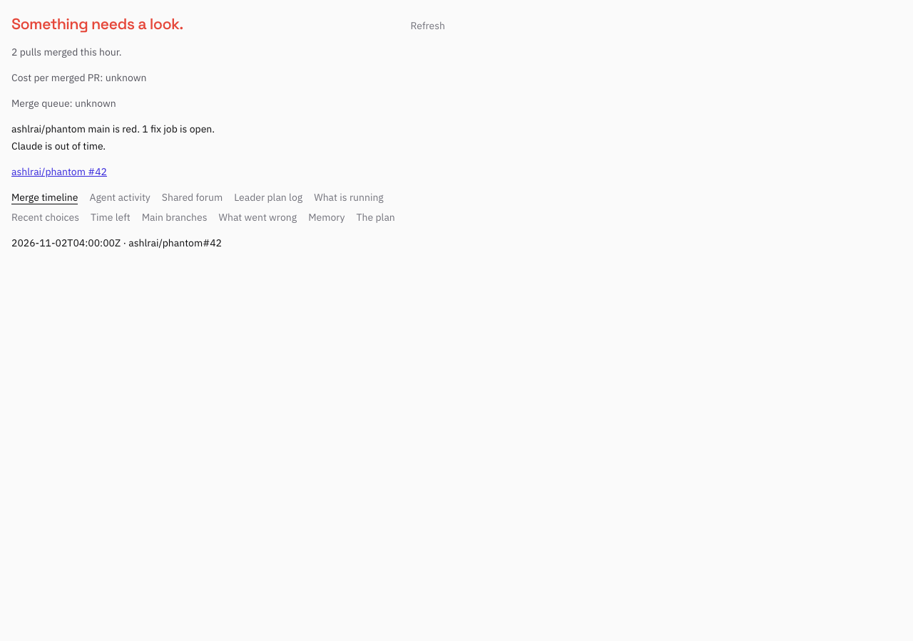

Fleet Mission now combines dispatchd activity, the existing fleet forum, leader VISION and PLAN-LOG, main guardian readings, hourly throughput and recorded merge timestamps. `phm app state --json` returns the same extended `fleet.mission.v1` document. File-driven SSE replaces Mission's polling timer. Missing billing and queue positions remain unknown.

Built on #2788 (bc-124196c5) and #2786, with no parallel Mission or forum reader and no duplicate bc-a46f053b work. Prepared the existing PR #3154 on fetched master 6b1ad2fe888, preserving the current app commands, API query validation, provider marks, resource freshness and managed-app work. All changes remain local and uncommitted.

Screenshot retained from the source commit (not recaptured in this worktree):

Validation and remaining limitations: see BRIDGE_NOTES.md. This is a local PR body draft; no PR, commit or push was created.
