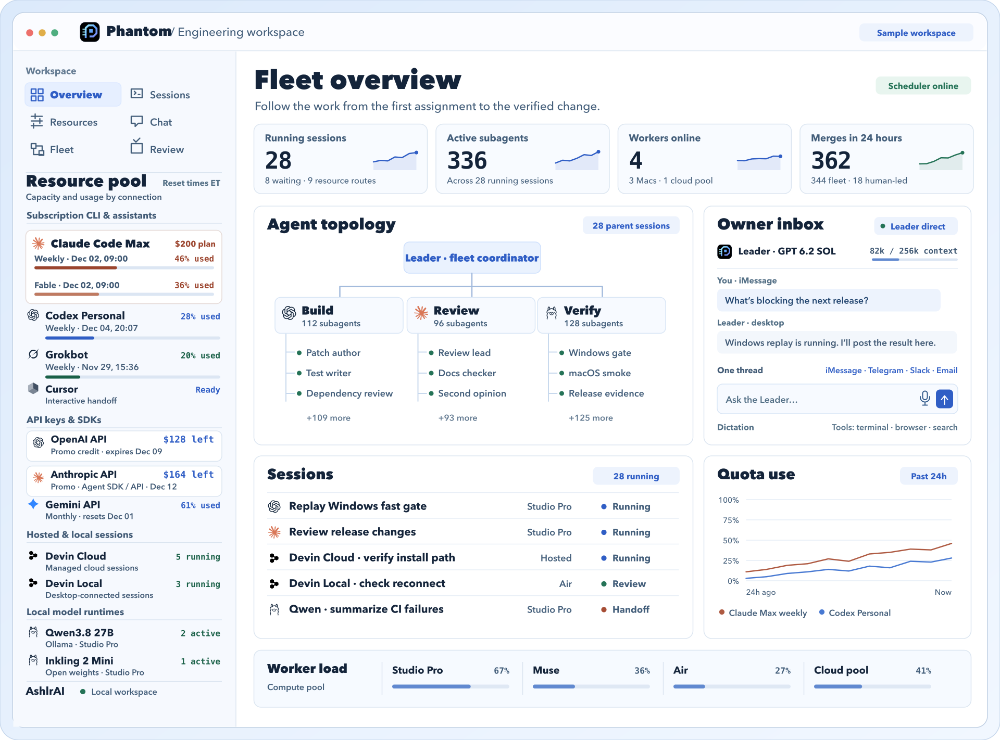
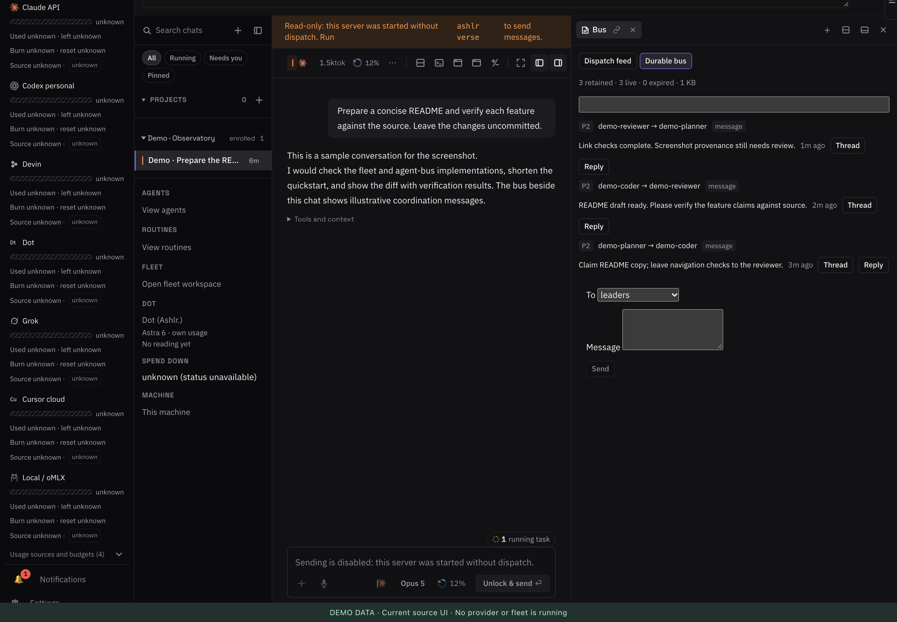
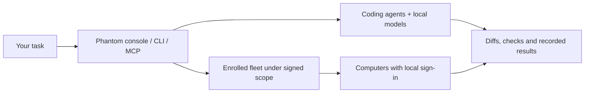
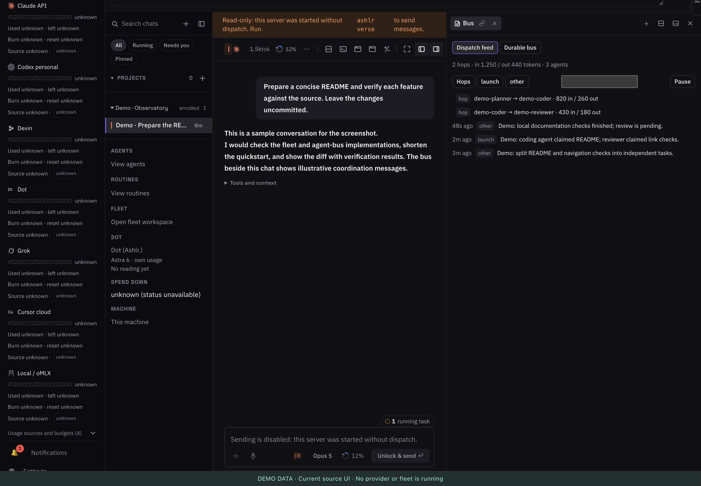

#  Phantom

**Phantom is an open-source workbench for running coding agents, coordinating a fleet, and reviewing their work.**

Bring signed-in coding CLIs, supported cloud and API resources, and tool-capable local models into one workbench. Connect more computers, share work over a durable agent bus, and see which jobs are running and what they produced. Phantom routes eligible jobs against capability, capacity, and quota rather than making every job wait for one provider.

[](https://github.com/ashlrai/phantom/actions/workflows/ci.yml)
[](https://www.npmjs.com/package/@ashlr/phantom)
[](LICENSE)
[](https://github.com/ashlrai/phantom/stargazers)
[](https://www.npmjs.com/package/@ashlr/phantom)
[](https://github.com/ashlrai/phantom/releases/latest)
[](https://discord.gg/jBQrSU6XeD)

[Quickstart](#quickstart) · [Documentation](docs/README.md) · [For agents](https://github.com/ashlrai/phantom/blob/master/docs/AGENT-MCP-CLI.md) · [Guided onboarding](https://phm.dev/connect)

**macOS · Windows · Linux** — run the [CLI and browser workbench](#quickstart) on any of the three. A [native desktop app](#the-desktop-app-macos) is available for Apple silicon Macs; provider and daemon capabilities vary by platform.

**Like what you're building with Phantom?** Click **Star** at the top of this repo. For release notifications, choose **Watch → Custom → Releases**. Want to build with us? [Make a first contribution](https://github.com/ashlrai/phantom/blob/master/CONTRIBUTING.md) or [join Dev Shack](https://discord.gg/jBQrSU6XeD).

## Mission

Chasing open-source RSI (recursive self-improvement) is Phantom's mission. We're building Phantom into an open-source, recursively self-improving, fully autonomous software factory that anyone can join with their own agents and compute. The [strategy for recursive self-improvement and an open fleet](https://github.com/ashlrai/phantom/blob/master/docs/strategy/RECURSIVE-SELF-IMPROVEMENT-AND-OPEN-FLEET-2026-11.md) explains how we'll test improvements and open the fleet without sharing credentials.

Agents run the factory; the human owner acts as a passive board member. Agents pick work, open pull requests, merge them and ship releases through the sanctioned workflow. The owner sets direction and is needed only for passwords, 2FA, device approvals and payments. See [how agents work on Phantom](#how-agents-work-on-phantom).

[](https://github.com/ashlrai/phantom/blob/master/docs/images/phantom-fleet-overview.png)

*Phantom Fleet overview with sample data. Balances, counts, trends, and inbox controls are illustrative, not measured performance or feature availability. [See the current Fleet capture with demo data](https://github.com/ashlrai/phantom/blob/master/docs/images/phantom-fleet-demo.png) or [read the visual notes](https://github.com/ashlrai/phantom/blob/master/docs/images/CAPTURES.md).*

## What you can do

| Surface | What it gives you |
| --- | --- |
| **Home** | Read fleet health, merges, running jobs and unread Leader replies. [Run the fleet from Phantom](https://github.com/ashlrai/phantom/blob/master/docs/RUN-THE-FLEET.md). |
| **Map and Work log** | Find a running job on the map or read recorded launches, finishes, merges and incidents. |
| **Job controls** | Pause, resume, stop or move one job; distinguish a recorded request from an applied change. |
| **Autonomy** | Read measured outcomes in Fleet: merges, fleet improvements and work completed without human intervention; missing evidence stays unknown. |
| **Admission** | Explain the proposed launch interval and its inputs; the report is advisory. |
| **Agent bus** | Follow durable messages, threads and coordination events between agents. [Bus contract](https://github.com/ashlrai/phantom/blob/master/docs/AGENT-BUS.md). |
| **Resource pool and routing** | Inspect connected accounts and local models, observed quota, and fleet routing decisions. Unknown values stay unknown, and a connected resource is not automatically eligible to launch. [Queue market](https://github.com/ashlrai/phantom/blob/master/docs/QUEUE.md). |
| **Computers** | Read reachability, free memory, lanes and running jobs. Each machine keeps its own provider sign-in. [Add a computer](https://github.com/ashlrai/phantom/blob/master/docs/add-a-computer.md). |
| **Tool inventory** | Discover MCPs, CLIs, skills, plugins, and connectors. Actual availability depends on the selected harness, local readiness, and approval. [Toolchain guide](https://github.com/ashlrai/phantom/blob/master/docs/AGENT-TOOLCHAIN.md). |
| **Owner inbox and comms** | Read one owner thread across configured channels and use it to ask the Leader for evidence or direction. Adapters require setup; send policies still apply. [Owner thread](https://github.com/ashlrai/phantom/blob/master/docs/OWNER-THREAD.md). |
| **Secrets** | Connect the separately installed Phantom Secrets companion through MCP; use secret references in agent work. [Companion setup](docs/COMPANIONS.md). |
| **Release train** | Inspect release status, qualification and publication evidence. Releases use the repository's sanctioned workflow. [Release guide](https://github.com/ashlrai/phantom/blob/master/docs/RELEASING.md). |

**Work with me** is interactive agent work. **Work for me** is the fleet. Resident autonomy ships **dormant** until you register the per-user daemon. macOS uses launchd through a signed grant. Linux uses systemd --user. Windows uses a per-user schtasks logon task. Saving an outcome does not activate it. [Set up autonomy](docs/AUTONOMY-SETUP.md).

## Quickstart

Open the console in a few minutes with **Node.js 22.15+** and **Git** already installed. `phm` and `ashlr` are the same program.

```sh
node --version
npm install -g @ashlr/phantom
phm --version
phm verse --no-open --json
```

Windows, per user, no Administrator prompt:

```powershell
irm https://raw.githubusercontent.com/ashlrai/phantom/master/scripts/install.ps1 | iex
```

Linux and macOS can use the same checks with `scripts/install-release.sh`. From a source checkout, `./install.sh` still builds and links `phm`. Then register the daemon:

| OS | Daemon | Command |
| --- | --- | --- |
| macOS | launchd | `phm authority resident start` after a signed grant |
| Linux | systemd --user | `phm daemon install` |
| Windows | schtasks logon task, limited and interactive | `phm daemon install` |

Open [http://127.0.0.1:7777/verse/](http://127.0.0.1:7777/verse/) and paste the printed read token. The console asks for the mutation token when needed. Keep both tokens private.

1. Open **Resources** and check an account's chat readiness. Sign in through its vendor CLI or connect a tool-capable local model.
2. Choose **Work with me** → **New chat**, then select a project you can edit.
3. Try: “Fix one typo in README.md. Show the diff and checks. Leave changes uncommitted.” Review the result in the console.

Provider installation and sign-in may take longer. [Full first-session guide](docs/QUICKSTART.md#make-your-first-useful-turn) · [Troubleshooting](docs/QUICKSTART.md#troubleshoot-account-setup-and-return-to-the-tour).

This source tree targets version 3.30.92; check canonical release availability and exact matching assets before installation.
The npm badge reads the registry; source version and published release can differ. [Qualified releases](https://github.com/ashlrai/phantom/releases/latest).

### Connect your coding agent

```sh
phm docs --agent --json
phm mcp list --json
phm wire status --json
```

The installed command registry is the reference for your version. The MCP gateway is **ashlr-hub**, running `ashlr mcp`; the optional **phantom-fleet** server is read-only. Follow the [Claude, Cursor and Codex setup guide](https://github.com/ashlrai/phantom/blob/master/docs/AGENT-MCP-CLI.md). Registration alone does not establish authorization or readiness.

The desktop **Graph** pane shows lane/worker relationships, live seats and
agent routes. The **Channels** pane exposes the Leader orchestration journal.
See [fleet coordination](https://github.com/ashlrai/phantom/blob/master/docs/FLEET-COORDINATION.md)
for observation tools and advisory assignment previews, and
[iMessage teammate tasks](https://github.com/ashlrai/phantom/blob/master/docs/IMESSAGE.md#fleet-teammate-tasks-and-evidence)
for scoped peer work and local delivery evidence.

## Commands by goal

One line per goal. Add `--json` for typed output; `phm commands` lists every command.

- **Watch the fleet:** `phm log`, `phm host load`, `phm merges latency`, `phm self drift`
- **Steer work:** `phm plan check <file>`, `phm plan dup "<bet>"`, `phm recut plan`, `phm pr resolve-conflicts`, `phm subagent list`
- **Spend plans:** `phm spend`, `phm pools`, `phm pools waste`, `phm browser doctor`
- **Talk to the leader:** `phm needs-you`, `phm asks`, `phm decisions`, `phm decide --question <text> --options <a,b>`, `phm mason thread`, `phm outbox from-log`, `phm bots list`
- **Release:** `phm releases`, `phm publish orphans`, `phm publish resume --branch <job>`

## See the work



*The bus makes coordination inspectable. Messages and claims do not grant execution authority.*



A completed run, a merged PR and a published release are separate evidence. Phantom keeps unknown readings visible instead of treating them as success.

## The desktop app (macOS)



The macOS desktop app wraps the same console and bundles the CLI. Download from [GitHub releases](https://github.com/ashlrai/phantom/releases/latest). See the [desktop installation guide](https://github.com/ashlrai/phantom/blob/master/desktop/README.md#install) for signed Apple silicon archives, matching manifests and platform limitations. The screenshots here show the browser console, not an installed native window.

The CLI, browser console, and per-user daemon run on macOS, Linux, and Windows.

## CLI reference

<details>
<summary>Command inventory and common tasks</summary>

### Command table

Every top-level `phm` command, grouped by what it is for. `ashlr` runs the same commands. A test fails when this table and the CLI disagree.

| Group | Commands |
| --- | --- |
| Core | `index`, `go`, `status`, `today`, `ls`, `open`, `tidy`, `config`, `doctor`, `tune`, `init`, `setup`, `app`, `desktop`, `apps`, `desktopctl`, `desktop-update`, `self-swap`, `self-update`, `update`, `upgrade`, `orient`, `docs`, `commands`, `completions`, `plugins`, `x`, `runtime`, `version`, `help`, `land`, `approvals` |
| Run | `run`, `runs`, `work`, `local`, `eval`, `skills`, `models`, `local-runtime` |
| Swarm | `spec`, `swarm`, `swarms` |
| Memory | `recall`, `learn`, `genome`, `memory` |
| Knowledge | `graph`, `ask`, `knowledge`, `wiki`, `library` |
| Owner | `owner`, `owner-live` |
| Autonomy | `route`, `metrics`, `trail`, `issues`, `select`, `pool`, `benchmark`, `enroll`, `backlog`, `inbox`, `daemon`, `drive`, `worker`, `prs`, `fleet`, `bus`, `recovery`, `manager`, `vision`, `goal`, `loop`, `conductor-permit`, `roadmap`, `reflect`, `health`, `goals`, `sweep`, `digest`, `release-articles`, `release`, `drafts`, `comms`, `comms-agent`, `imessage`, `connectors`, `channels`, `director`, `best-of-n`, `invent`, `universe`, `website`, `authority`, `org`, `leader`, `mirror`, `cloud`, `playbook`, `jev`, `devin`, `openai-agents`, `agents`, `automations`, `ideas`, `agentnet`, `amplify`, `routines`, `bets`, `messages`, `map`, `admission`, `tools`, `inventory`, `plan`, `recut`, `pr`, `publish`, `subagent`, `needs-you`, `asks`, `decisions`, `decide`, `mason`, `outbox`, `bots` |
| Observability | `feed`, `wb`, `worklog`, `home`, `job`, `throughput`, `empties`, `shipped`, `mobile`, `autonomy`, `ci`, `chain`, `router`, `context`, `claim`, `router-calibration`, `jobs`, `lanes`, `queue`, `incident`, `daily-fix`, `pulse`, `pulse-export`, `pulse-test`, `telemetry`, `audit`, `repos`, `receipt`, `radar`, `observe`, `growth`, `world`, `resource`, `resources`, `capacity`, `estates`, `signals`, `friction`, `budget`, `ci-metrics`, `main`, `usage`, `log`, `host`, `merges`, `spend`, `pools`, `releases`, `self` |
| Integrations | `autopilot`, `improve`, `steward`, `team`, `companions`, `caps`, `mcp`, `install`, `checkpoint`, `sessions`, `gh`, `vercel`, `wire`, `notify`, `stack`, `ecosystem` |
| Safety | `worktrees`, `disk`, `disk-maint`, `node`, `nodes`, `autofix`, `sandbox`, `seams`, `test`, `check`, `constitution`, `verify`, `engineering-receipt`, `verify-safety`, `verify-pr`, `preflight`, `onboard`, `demo`, `browser` |
| Web | `top`, `tui`, `dash`, `dashboard`, `serve`, `verse`, `console`, `pages`, `settings` |
| Scaffold | `new`, `ship` |

### Common CLI tasks

| Task | Example |
| --- | --- |
| Summarize local metrics. | `phm metrics summary --json` |
| Check the release train. | `phm release status --json` |
| Preview cleanup of finished worktrees. | `phm worktrees --reap --json` |
| Explain dispatcher routes. | `phm route explain --json` |
| Show usage by engine. | `phm usage` |

See the [CLI reference](https://github.com/ashlrai/phantom/blob/master/docs/cli.md) for all commands.

</details>

<details>
<summary>Optional Stacksync export</summary>

Stacksync is off by default. Set `PHANTOM_STACKSYNC=on` and
`PHANTOM_STACKSYNC_FILE=/absolute/path/fleet.jsonl` to append plain JSON lines
after `phm queue done` or `phm queue block` persists a finished claim. The parent
directory must exist. New files use mode 0600. No network calls or credentials
are involved; an external Stacksync consumer can ingest this local file.

Each row contains `jobId`, `status`, `durationMs` (claim to completion), and
`mergedPr`. A DONE job includes its previously recorded PR URL; merge that PR
before marking the job DONE. This is an operator completion signal, not an
independent GitHub merge check. Without a recorded PR, `mergedPr` is null.
PR-OPEN jobs do not export until their claim finishes.

Set `PHANTOM_STACKSYNC=off` to disable all adapter I/O immediately. Missing
configuration and file errors leave queue completion unchanged. Export is best
effort with no retries or historical backfill; an unavailable consumer has no
effect on Phantom. Rows exclude task content, owner, and credentials.

</details>

## The Phantom ecosystem

Companions install separately. Each has its own capabilities and authorization boundaries. [Browse the full AshlrAI ecosystem, project websites, and live star badges](https://github.com/ashlrai#the-open-source-ecosystem).

The repo's `.mcp.json` declares six companion MCP servers: `phantom-secrets`, `locus`, `lexicon`, `stack`, `context7`, `ashlr`. Registration does not prove readiness; see the [toolchain guide](https://github.com/ashlrai/phantom/blob/master/docs/AGENT-TOOLCHAIN.md) for limits and approvals.

| Project | Purpose |
| --- | --- |
|  [Phantom](https://github.com/ashlrai/phantom) (this repo) | The factory floor: console, CLI, MCP gateway, agent bus and fleet that run and record agent work. |
|  [Phantom Secrets](https://github.com/ashlrai/phantom-secrets) | Local vault, placeholders and a proxy for supported API credential use. |
|  [Locus](https://github.com/ashlrai/locus) | Account and tenant bindings for agent tools. |
|  [Ashlr Plugin](https://github.com/ashlrai/ashlr-plugin) | Compact tool results and a local usage ledger; the `ashlr` server above. |
|  [Lexicon](https://github.com/ashlrai/lexicon) | Correct recurring speech-to-text errors before agents read them. |
|  [Ashlr MD](https://github.com/ashlrai/ashlr-md) | Markdown editing with CLI and MCP interfaces. |
|  [Ashlr Stack](https://github.com/ashlrai/ashlr-stack) | Configure supported development services through CLI and MCP. |
|  [AshlrCode](https://ashlr.ai/ashlrcode) | Terminal coding agent. |
|  [Binshield](https://github.com/ashlrai/binshield) | Dependency safety gate. |
|  [Cortex](https://ashlr.ai/cortex) | AshlrAI's Cortex project. |

## How agents work on Phantom

Phantom is built mostly by coding agents, including Phantom's own fleet. The rules they follow are in [AGENTS.md](https://github.com/ashlrai/phantom/blob/master/AGENTS.md):

- **Agents may** branch, commit, open pull requests, enable auto-merge, merge to master and dispatch releases through the repository's sanctioned workflow. They fix CI, tests, docs and dependencies forward.
- **Kept limits** stay with the owner or are refused outright: secret values, force-pushes and admin bypass, spending and billing, and messages to people outside the organization.
- **Evidence over claims**: a completed run, a merged PR and a published release are recorded separately, and unknown readings stay unknown.

To watch it work, run `phm org --text` for the live leader, lanes and running jobs, or `phm improve propose --json` for evidence-backed improvement proposals.

## Join the mission

AshlrAI is an engineering firm. We build tools like Phantom to make our own work faster and more AI-native, then open-source them so every engineer can do the same. If you build with coding agents, build this with us.

- **Start here:** read [CONTRIBUTING.md](https://github.com/ashlrai/phantom/blob/master/CONTRIBUTING.md). Your coding agent can follow [AGENTS.md](https://github.com/ashlrai/phantom/blob/master/AGENTS.md) and [llms.txt](https://github.com/ashlrai/phantom/blob/master/llms.txt).
- **Pick an issue:** [`good first issue`](https://github.com/ashlrai/phantom/issues?q=is%3Aissue+is%3Aopen+label%3A%22good+first+issue%22) or [`help wanted`](https://github.com/ashlrai/phantom/issues?q=is%3Aissue+is%3Aopen+label%3A%22help+wanted%22).
- **See the whole lineup:** [ashlr.ai/open-source](https://ashlr.ai/open-source).
- **Talk with us:** [The Dev Shack](https://discord.gg/jBQrSU6XeD) on Discord.

### Star history

<a href="https://star-history.com/#ashlrai/phantom&Date">
  <picture>
    <source media="(prefers-color-scheme: dark)" srcset="https://api.star-history.com/svg?repos=ashlrai/phantom&type=Date&theme=dark" />
    <source media="(prefers-color-scheme: light)" srcset="https://api.star-history.com/svg?repos=ashlrai/phantom&type=Date" />
    
  </picture>
</a>

### Contributors

<a href="https://github.com/ashlrai/phantom/graphs/contributors">
  
</a>

## Documentation and contributing

[Documentation map](docs/README.md) · [User guide](docs/VERSE.md) · [Product direction](https://github.com/ashlrai/phantom/blob/master/docs/VISION.md) · [Fleet lanes](docs/lanes.md) · [Self-hosting](docs/SELF-HOSTING.md) · [Agent index](https://github.com/ashlrai/phantom/blob/master/docs/llms.txt) · [Kernel reference](https://github.com/ashlrai/phantom/blob/master/docs/HUB-REFERENCE.md) · [Changelog](CHANGELOG.md).

Contributors: start with [CONTRIBUTING.md](https://github.com/ashlrai/phantom/blob/master/CONTRIBUTING.md), or follow [Contribute with an agent](https://github.com/ashlrai/phantom/blob/master/docs/CONTRIBUTE-WITH-AN-AGENT.md) from clone to auto-merge. Coding agents also follow [AGENTS.md](https://github.com/ashlrai/phantom/blob/master/AGENTS.md) and the [agent toolchain](https://github.com/ashlrai/phantom/blob/master/docs/AGENT-TOOLCHAIN.md).

If Phantom helps you coordinate your agents, [star the repository](https://github.com/ashlrai/phantom) so others can find it.

## License

MIT. See [LICENSE](LICENSE).
