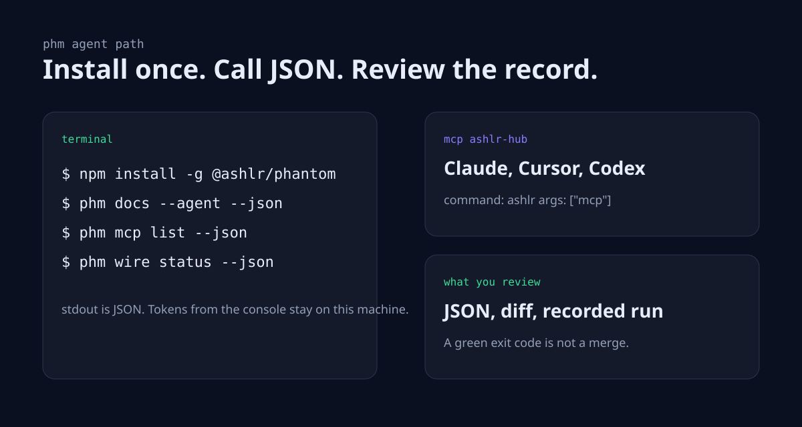
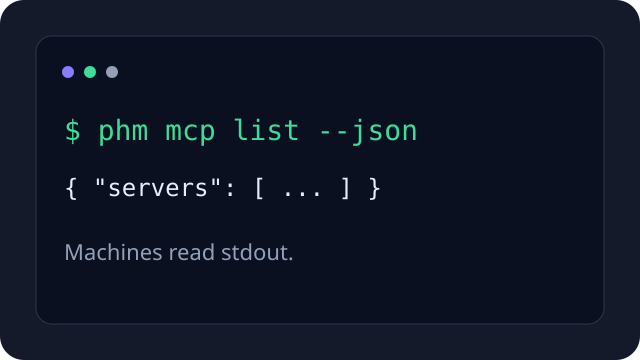
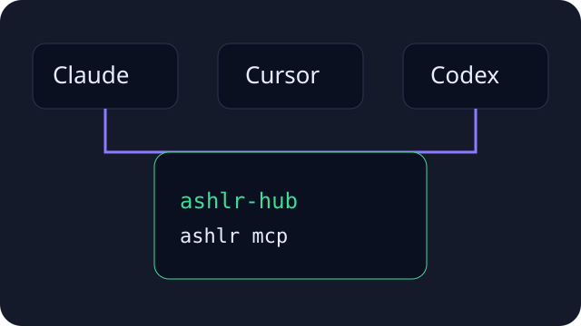
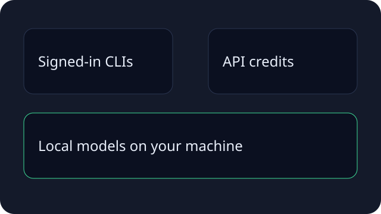
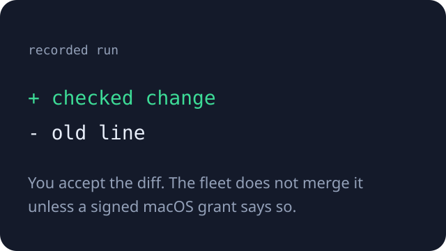
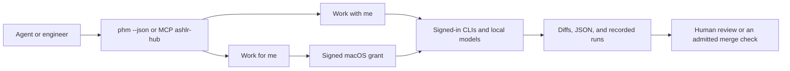

# Phantom

**Phantom runs all engineering and manages resources.**

Phantom is the open-source engineering agent workbench from [AshlrAI](https://ashlr.ai). An agent installs one command, calls the CLI with `--json`, or connects the MCP gateway. A person uses the same tools to chat with a signed-in coding agent, or to hand the fleet a result and review the record.

Agents start here. Humans can use the same commands.

[Agent index](https://github.com/ashlrai/phantom/blob/master/docs/llms.txt) ·
[Full agent reference](https://github.com/ashlrai/phantom/blob/master/docs/llms-full.txt) ·
[Onboarding](https://phm.dev/connect) ·
[User guide](docs/VERSE.md) ·
[GitHub](https://github.com/ashlrai/phantom)

[](https://github.com/ashlrai/phantom/actions/workflows/ci.yml)



## Quickstart

One install. Node.js 22.15.0 or newer. `phm` and `ashlr` are the same program.

```sh
node --version
npm install -g @ashlr/phantom
phm --version
phm docs --agent --json
```

This source tree targets version 3.29.16; check canonical release availability and exact matching assets before installation.
Install the promoted npm `latest` release, or pin a published version from
[GitHub releases](https://github.com/ashlrai/phantom/releases/latest).
The source tree is not proof that npm has that version yet.

Open the console when a person wants the app. It listens on `127.0.0.1` only and prints a read token and a mutation token. Neither token is written to disk.

```sh
phm verse --no-open --json
```

The page is [http://127.0.0.1:7777/verse/](http://127.0.0.1:7777/verse/). Paste the read token once. The page asks for the mutation token the first time you change something. Do not paste either token into a PR, issue, or chat log.

New here? [phm.dev/connect](https://phm.dev/connect) is the guided onboarding path. The [first-run guide](docs/QUICKSTART.md#open-verse) covers the same ground in this repository.

### Commands that print JSON

Run these after install. They read local state. They do not start a fleet or spend credits.

```sh
phm docs --agent --json
phm mcp list --json
phm mcp doctor --json
phm wire status --json
phm authority status --json
```

`phm docs --agent --json` is the command list for the binary you installed. Prefer it over a copied example when the two differ. `phm mcp doctor` exits 1 when a required server is down. That is a health result. `phm authority status --json` reports the grant. Autonomy ships dormant. A status command does not turn it on.

### MCP gateway

The gateway server key is `ashlr-hub`. The process is `ashlr` with args `mcp`. `phm wire` backs up the editor file, then writes that entry. It is safe to run again.

```sh
phm wire claude --json
phm wire cursor --json
phm wire codex --json
phm wire status --json
```

Claude Code reads `~/.claude.json`. Cursor reads `~/.cursor/mcp.json`. Paste this under `mcpServers` if you would rather not run `phm wire`. Claude's entry also sets `type` and `env`. Cursor's entry is the two fields below.

```json
{
  "mcpServers": {
    "ashlr-hub": {
      "command": "ashlr",
      "args": ["mcp"]
    }
  }
}
```

Codex stores servers in `~/.codex/config.toml`. Do not hand-edit that file. `phm wire codex` runs `codex mcp add ashlr-hub -- ashlr mcp` after a backup. The `codex` program must be on `PATH`.

Restart the editor after the file changes. Registration does not prove the server started. Check with `phm wire status --json` and `phm mcp doctor --json`.

The read-only fleet server is a second entry. It does not launch work or merge.

```json
{
  "mcpServers": {
    "phantom-fleet": {
      "command": "phm",
      "args": ["mcp", "fleet"]
    }
  }
}
```

Details: [self-hosting](docs/SELF-HOSTING.md#connect-claude-code-and-codex-over-mcp) and [fleet MCP](https://github.com/ashlrai/phantom/blob/master/docs/FLEET-MCP-ONRAMP.md).


*Compiled 3.24.3 browser UI with labeled Demo accounts. No provider ran and no fleet was active. The screenshot shows the browser UI, not the native app window.*

## Features

| | |
| --- | --- |
|  | **CLI for agents.** `phm docs --agent --json` lists commands. Add `--json` on commands that offer it. |
|  | **One MCP gateway.** Claude, Cursor, and Codex use `ashlr-hub`. |
|  | **Your accounts.** Claude Code, Codex, Grok, Devin, API credits, and tool-capable local models. Phantom does not ask for or store the vendor credential. |
|  | **A record you can review.** Chats, diffs, checkpoints, and fleet runs stay in the console. A finished run is not proof the outcome shipped. |

**Work with me** is the chat. **Work for me** is the fleet. Saving a fleet outcome does not start work and does not widen permission. The fleet runs only in enrolled repositories under a signed grant. Autonomy ships **dormant** and is macOS-only.

## Compare

No scores. This is what the install changes.

| | Phantom | Each coding CLI on its own |
| --- | --- | --- |
| Install for an agent | `npm install -g @ashlr/phantom` | That vendor's installer |
| Machine output | `phm <command> --json` where the command offers it | That CLI's own flags |
| MCP | `ashlr-hub` via `phm wire claude`, `phm wire cursor`, or `phm wire codex` | You register each server yourself |
| Whose account | The account that CLI already uses | The same account |
| Local models | A running Ollama exposes tool-capable tags as seats | You point each tool at the server |
| Unattended fleet | Off until you sign a macOS grant and start the resident daemon | Not this product |
| Review | Console diffs, checkpoints, and recorded runs | That CLI's own session |

A connected account is not permission to spend credits. Check readiness before you delegate. [Resource evidence](docs/RESOURCE-EVIDENCE.md) says what each reading means.

## How work moves



Independent ready tasks can use more than one admitted resource. Slots, quotas, budget reserves, and the signed grant limit how much runs at once. Open **Resources** in the console to see chat readiness and fleet readiness separately. Unknown stays unknown.

## FAQ

**Does Phantom store my API keys?**
No. Each vendor CLI signs itself in. Phantom does not ask for or store that credential.

**What Node version do I need?**
22.15.0 or newer. `node --version` must print that before `npm install -g @ashlr/phantom`.

**What is the difference between `phm` and `ashlr`?**
They are the same program. `phm` is the primary name. Scripts that call `ashlr` keep working. The separate Phantom Secrets command is `phantom`.

**Is autonomy already running?**
No. It ships dormant and is macOS-only. It starts after you install the custody helper, sign a Touch ID grant, and start the resident daemon. `phm authority status --json` reads the state. It does not turn autonomy on.

**Does a zero exit code mean the task shipped?**
No. Read the JSON. A health command can exit 0 when work is held. A recorded run is not a merge, a release, or proof the outcome was delivered.

**Where is the long agent page?**
[docs/llms.txt](https://github.com/ashlrai/phantom/blob/master/docs/llms.txt) is the short index. [docs/llms-full.txt](https://github.com/ashlrai/phantom/blob/master/docs/llms-full.txt) is the copy-paste reference.

## Star Phantom

If this workbench is useful, star [ashlrai/phantom](https://github.com/ashlrai/phantom). A star helps the next engineer or agent find it. This page does not print a star count. GitHub has the live number.

## The desktop app (macOS)

The desktop app is a native window around the same console. It bundles the CLI, so the app itself does not need a separate Node.js install.

Download the signed arm64 archive and paired update manifest from [GitHub releases](https://github.com/ashlrai/phantom/releases/latest). Match the archive to the installed CLI version. The app is locally signed, not Apple notarized, so macOS may ask for **Open Anyway** on first launch. Steps: [desktop installation guide](https://github.com/ashlrai/phantom/blob/master/desktop/README.md#install).

```sh
phm verse
```

Closing the window hides it. **Quit** stops the server. Building from source is in [Releasing locally](https://github.com/ashlrai/phantom/blob/master/docs/RELEASING-LOCALLY.md).

## The CLI

The console also runs from the CLI on macOS, Linux, and Windows. You need Node.js 22.15 or newer and Git.

```sh
npm install -g @ashlr/phantom
phm --version
phm verse
```

`phm verse` serves [http://127.0.0.1:7777/verse/](http://127.0.0.1:7777/verse/). The package exports `@ashlr/phantom`, `@ashlr/phantom/core`, `@ashlr/phantom/types`, `@ashlr/phantom/plugin`, and `@ashlr/phantom/universe`.

Optional cloud handoff, off unless you launch it:

```sh
phm cloud launch "<task>" --repo owner/name
phm devin connect
phm devin launch "<task>"
```

Cloud lanes do not merge by themselves. See [Cloud](docs/CLOUD.md) and [Devin](docs/DEVIN.md).

Inspect autonomy without turning it on:

```sh
phm authority setup --dry-run --json
phm authority status --json
```

Commissioning steps: [Autonomy setup](docs/AUTONOMY-SETUP.md).

## The Phantom ecosystem

Phantom is the workbench. These projects stay useful on their own. The [ecosystem page](https://verse.ashlr.ai/ecosystem) charts a dated GitHub star history for six repositories. The chart adds the six totals. It is not a count of unique people. Each repo has its own install and its own live star count.

| Project | What it helps with |
| --- | --- |
| **[Phantom](https://github.com/ashlrai/phantom)** | Coordinate coding agents, accounts, local models, and guarded fleet work. |
| **[Phantom Secrets](https://github.com/ashlrai/phantom-secrets)** | Manage credentials. A proxy path can keep a raw key out of agent context. Some API adapters still reveal a key in-process for a call. |
| **[Locus](https://github.com/ashlrai/locus)** | Check configured account and session identity. Off, warn, enforce, and firm do different things. |
| **[Lexicon](https://github.com/ashlrai/lexicon)** | Correct names and technical terms from speech-to-text before they reach an agent. |
| **[AshlrCode](https://github.com/ashlrai/ashlrcode)** | Run a multi-provider coding agent in the terminal. |
| **[Morphkit](https://github.com/ashlrai/morphkit)** | Turn a TypeScript/React app into a SwiftUI project. |

The [ecosystem map](https://github.com/ashlrai/phantom/blob/master/docs/ECOSYSTEM-MAP.md) is a planning snapshot, not a claim that every integration is live.

## Documentation

| Doc | Use it for |
| --- | --- |
| [docs/llms.txt](https://github.com/ashlrai/phantom/blob/master/docs/llms.txt) | Short index for agents |
| [docs/llms-full.txt](https://github.com/ashlrai/phantom/blob/master/docs/llms-full.txt) | Copy-paste install, JSON commands, and MCP setup |
| [docs/QUICKSTART.md](docs/QUICKSTART.md) | First local session |
| [docs/SELF-HOSTING.md](docs/SELF-HOSTING.md) | Install, MCP, upgrade, uninstall |
| [docs/VERSE.md](docs/VERSE.md) | Console guide |
| [docs/README.md](docs/README.md) | Full doc map |
| [docs/HUB-REFERENCE.md](https://github.com/ashlrai/phantom/blob/master/docs/HUB-REFERENCE.md) | Kernel reference: Universe, resource pools, and the legacy fleet |
| [CHANGELOG.md](CHANGELOG.md) | Release history |

## Working on this repository

Agents that change this repo follow [AGENTS.md](https://github.com/ashlrai/phantom/blob/master/AGENTS.md). Humans follow [CONTRIBUTING.md](https://github.com/ashlrai/phantom/blob/master/CONTRIBUTING.md).

For agents working in this checkout, `.mcp.json` declares `phantom-secrets`, `locus`, `lexicon`, `stack`, `ashlr`. These companion servers are separate from Phantom's aggregation gateway (`phm mcp`). Registration and discovery do not establish authorization or live readiness. See the [agent toolchain](https://github.com/ashlrai/phantom/blob/master/docs/AGENT-TOOLCHAIN.md).

## Optional Stacksync export

Stacksync is off by default. Set `PHANTOM_STACKSYNC=on` and
`PHANTOM_STACKSYNC_FILE=/absolute/path/fleet.jsonl` to append plain JSON lines
after `phm queue done` or `phm queue block` persists a finished claim. The parent
directory must exist. New files use mode 0600. No network calls or credentials
are involved; an external Stacksync consumer can ingest this local file.

Each row contains `jobId`, `status`, `durationMs` (claim to completion), and
`mergedPr`. A DONE job includes its previously recorded PR URL; merge that PR
before marking the job DONE. This is an operator completion signal, not an
independent GitHub merge check. Without a recorded PR, `mergedPr` is null.
PR-OPEN jobs do not export until their claim finishes.

Set `PHANTOM_STACKSYNC=off` to disable all adapter I/O immediately. Missing
configuration and file errors leave queue completion unchanged. Export is best
effort with no retries or historical backfill; an unavailable consumer has no
effect on Phantom. Rows exclude task content, owner, and credentials.

## License

MIT. See [LICENSE](LICENSE).
