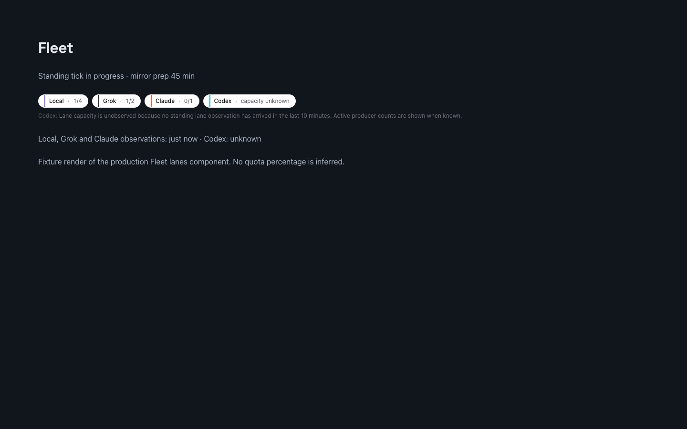

# Fleet lane observation screenshot

The image is a 1440 by 900 Playwright render in headless Chrome of the production `LanesStrip`
component from `FleetCards.tsx`, including the production CSS modules and design
tokens. It uses synthetic slot counts and a 45-minute mirror-prep label. No live
account data or credentials were used. It is UI fixture evidence, not evidence
that a production daemon was restarted or that a provider was contacted.

The Codex fixture has no current slot observation; its chip says capacity is
unknown. Other chips show observed slots and working counts, with no inferred
usage percentage.
