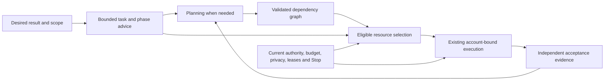

# Automatic routing research and evaluation proposal

Phantom should let a user describe the result while it chooses capable planning,
efficient execution and independent review within the resources already admitted
for that work. This guide explains the source foundation, gaps and proposed
next steps. For supported usage, start with [Automatic work](AUTOMATIC-OUTCOMES.md)
and the [Jev integration contract](JEV-INTEGRATION.md).

**Status: research and proposed implementation.** Phantom source was reviewed at
`0af2d9edc0f9300464bf8a764c6fab6fc8455f21`; public research was checked on
2026-10-14. This document changes no default, grant, installation, provider
configuration or runtime. No model benchmark was run. Source behavior does not
establish readiness of an installed release or a connected account.

## What the source supports

| Component | Current contract and limit |
| --- | --- |
| Chat Automatic | [Auto preferences and advisor projection](../src/web-ui/routes/verse/multimodel/useAutoSeat.ts) default to Auto, classify the draft locally and project the first runnable model per seat. The [send interceptor](../src/web-ui/routes/verse/multimodel/MultiModelBar.tsx) can obtain a Jev label before selecting a route. This is account routing, not enumeration of every model/context variant. |
| Context fit | [Capacity projection](../src/core/routing/headroom.ts) receives a model ID for tier/funding metadata but copies the seat's headline context window. A smaller alternative must use its own window before fit is claimed. |
| Continuation and refusal | The interceptor compares seat IDs rather than full model/context identity. When advice has no choice, it currently returns `send-here`; all-held advice therefore does not itself preserve an unsent draft. Failed cross-seat handoff does return `held`. These are specific gaps, not proof that the server would authorize an invalid turn. |
| Leader planning | [Leader](../src/core/vision/leader.ts) can refine an active desired outcome through a bounded task graph, with current class A authority and corrective retry/backoff. The [outcome port](../src/core/vision/leader-outcomes.ts) preserves scope, enrolled targets and risk limits; a memo label is not planning progress. |
| Planning model choice | [Leader seat routing](../src/core/vision/leader-seat.ts) examines source-discovered model variants, applies context/current capacity and role grants, then selects one variant per real account. Models on an account share its allowance. |
| Manager | The [manager bridge](../src/core/daemon/outcome-manager.ts) emits ordinary resident queue work for plan, review and replan. Its [coordinator](../src/core/goals/outcome-manager.ts) binds scope, conversation/evidence basis and exact route. Stale results cannot publish a current plan; there is no separate provider launcher here. |
| Execution ranking | [SeatRouter](../src/core/routing/router.ts) admits before ranking. It uses headroom, funding categories and explicit preferences. Unmeasured quality is neutral; legacy aggregate latency is diagnostic rather than an operational rank. |
| Jev advice | [Prompt labeling](../src/core/verse/multimodel/label.ts) has deterministic fallback. [Resource-choice advice](../src/core/decide/resource-choice.ts) exposes bounded ordinal choices over an already eligible set. Jev cannot create approval, account access or spare capacity. |
| Timing and learning | [Scheduling](../src/core/routing/scheduling.ts) joins completed metadata to exact account/model/task observations where available. [Chat feedback](../src/core/verse/multimodel/learning.ts) is a bounded preference tilt. [Operational learned routing](../src/core/run/learned-router.ts) has separate authenticated assignment/cohort, denominator, propensity and sample-floor gates. |
| Research lab | The [offline routing lab](../src/core/proactive/routing-lab.ts) records deterministic shadow and synthetic fixture receipts. Propose/withdraw preference is not live policy adoption. [Engineering outcome observations](../src/core/resources/engineering-outcomes-types.ts) do not grant routing authority or production acceptance. |

Prompt labeling, automation trigger triage and native execution admission are
separate mechanisms. A unified production phase decision across planner,
executor and reviewer is proposed below; existing classification alone does not
provide it. A [static model catalog](../src/core/run/model-catalog.ts) supplies
historical priors/defaults, while [native catalog projection](../src/core/verse/model-windows.ts)
and [seat discovery](../src/core/verse/seats.ts) describe actual candidate IDs.
Neither source declares a universally best model.

One legacy seam needs its own correction: [goal decomposition](../src/core/goals/planner.ts)
checks for an allowed installed Claude/Codex engine, but its planning `runGoal`
call does not pass that engine. [The orchestrator](../src/core/run/orchestrator.ts)
defaults an omitted engine to `builtin`. Its frontier-first comments therefore
do not bind the claimed frontier invocation. Reuse the current account-bound
Leader/Manager path for the proposed design.

## Proposed decision flow

Keep Automatic as the simple entry point, with explicit overrides under existing
Advanced controls. Routine, complete deliverables can proceed directly. Work
with dependencies, uncertain design or material recovery needs a plan. A
qualified planning resource defines the deliverables; ready tasks independently
select sufficient executors; review evaluates the result against acceptance.
A provider name, expensive price, Heavy badge or inferred tier cannot fill a
missing capability or quality measurement.

The new phase/route advice should remain data. Existing execution owners enforce
current authority, privacy, funding, account identity, lease, repository locks,
serving slots and cancellation immediately before contact. Advice, a saved
profile, a successful POST or a cached receipt cannot reserve future authority.

### Closed candidates and exact context

Enumerate actual catalog model/context/effort variants supported by the current
adapter. Exclude unavailable, hidden, nonselectable and incompatible options
before ranking. Keep unknown source, funding, privacy and capability states
explicit. Any fallback must be inside the same admitted set; misspelled model
preferences must not expand it.

Bind a candidate to its real account, engine, exact model, supported context mode
and adapter/CLI identity. Assess fit against that model/mode's actual allocation,
including retained conversation and expected output. Larger context is not a
quality score. Multiple candidates on one account cannot duplicate allowance,
concurrency slots or reservations. Local models also share hardware capacity.
Use [reset-aware scheduling](RESET-AWARE-SCHEDULING.md) and the existing
[resource pool contract](RESOURCE-POOLS.md), not a second queue.

### Continuity and all-held behavior

Keep the current binding while it remains eligible and adequate. Distinguish a
supported same-account model change from a cross-account handoff. Existing
[model controls](../src/core/verse/session-engine.ts) and
[handoff flows](../src/web-ui/routes/verse/multimodel/multimodel-flows.ts)
remain the owners. Switching must account for context rebuild, cache loss,
continuity and ambiguous in-flight work; a model recommendation is not a
portable native session.

Proposed all-held behavior preserves the draft and shows the concrete hold.
An explicit manual override follows its ordinary server checks; Automatic must
not silently convert a refusal into `send-here`. Advice must carry a full binding
identity so a different model on the same seat is not mistaken for no change.
Late response, changed chat/scope, lost lease, pause/Stop and cancellation must
invalidate the decision before sending or starting a handoff.

### Bounded planner and advisor

Planning, recovery and review can use a stronger qualified resource without
routing every extraction, formatting or test-summary step through it. Supply a
compact cited evidence packet and immutable acceptance/scope basis, rather than
an unrestricted transcript. Enforce call, input/output and deadline bounds through
existing transports; reserve/reconcile actual usage. Complexity advice is not
risk authorization. Quoted imported instructions and model plans cannot create
grants, roles, execution commands or privileged memory.

No comparative quality evidence means no fabricated best-model score. Preserve
the existing stable baseline or a deliberate operator preference until qualified
observations support a different choice. Prospective high-leverage work can gain
priority from a falsifiable value hypothesis and independently checked result;
ambitious wording, task volume and self-reported success cannot earn that credit.

## Useful product mechanisms and limits

Public documentation describes its own service, not Phantom account entitlements
or native adapter support. The following mechanisms were checked on 2026-10-14;
all proposed Phantom adaptations are inferences.

| Primary product evidence | Transferable idea and boundary |
| --- | --- |
| [OpenRouter Auto](https://openrouter.ai/docs/guides/routing/routers/auto-router) and [provider selection](https://openrouter.ai/docs/guides/routing/provider-selection) | Separate task/model choice from endpoint load balancing. Preserve continuity and distinguish soft speed preferences from hard price/privacy limits. Recent aggregate popularity is a prior, not independent task quality. API routing cannot supply Phantom subscription access. |
| [Hosted Jev Router](https://openrouter.ai/docs/guides/routing/routers/jev-router) | Model and reasoning-effort advice can adapt across supported turns. Cost tiers are preferences, not hard caps. Its unmatched include list can be ignored; Phantom's closed eligible set must remain strict. This hosted API is distinct from Phantom's direct TypeSafe decision adapter. |
| [OpenRouter advisor](https://openrouter.ai/docs/guides/features/server-tools/advisor) and [subagent](https://openrouter.ai/docs/guides/features/server-tools/subagent) tools | Bounded consultation and self-contained delegation are useful separate roles. The advisor defaults to forwarding only its supplied prompt. Phantom must own stable advisor identity, sharing scope and limits; beta tool behavior is not a native integration or inherited grant. |
| [NVIDIA Switchyard stage guide](https://raw.githubusercontent.com/NVIDIA-NeMo/Switchyard/main/docs/routing_algorithms/stage_router_routing.md) and [typed tool signals](https://raw.githubusercontent.com/NVIDIA-NeMo/Switchyard/main/crates/libsy/src/algorithms/util/tool_signals.rs) | Recovery hysteresis can distinguish actual executed failures/tests from retrieved prose. Do not copy thresholds as calibrated Phantom settings or infer quality from price-assigned roles. These mutable source links describe a library, not all hosted routing internals. |
| [LiteLLM routing](https://docs.litellm.ai/docs/routing), [adaptive router](https://docs.litellm.ai/docs/adaptive_router) and [v1.105.0 latency source](https://raw.githubusercontent.com/BerriAI/litellm/v1.105.0/litellm/router_strategy/lowest_latency.py) | Deployment balancing and semantic routing are different. Feedback-based adaptation is a comparison baseline, not verified engineering quality. Cold-start zero latency in the inspected strategy is exploration, not a measured sample. Include counter/coordination overhead. |
| [Portkey balancing](https://portkey.ai/docs/product/ai-gateway/load-balancing), [fallbacks](https://portkey.ai/docs/product/ai-gateway/fallbacks) and [circuit breaker](https://portkey.ai/docs/product/ai-gateway/circuit-breaker) | Stickiness, ordered attempts and canaries help reliability. Phantom must retain all attempts and return held when its eligible set is exhausted. An all-open breaker bypass is not a safe substitute for admission. |
| [Not Diamond training](https://docs.notdiamond.ai/docs/router-training-quickstart) and [selection API](https://docs.notdiamond.ai/reference/token_model_select_v2_modelrouter_modelselect_post) | Per-model scored outcomes are a useful training format. Freeze independent held-out data and task rubrics; custom average latency cannot establish current queue load or account allowance. A recommendation remains distinct from execution. |
| [Current Unify product](https://unify.ai/) and [official archived repository](https://github.com/unifyai/unify) | Capture, score and evaluate candidate changes before adoption. Historical routing interfaces were not requalified in this review; unavailable legacy documentation is uncertainty, not proof of absence. Model-weight training would be a separate project. |

## Research with versioned scope

These are primary author papers, checked 2026-10-14, with author-reported results;
none was reproduced in Phantom. The first four are background. The remaining
papers inform method and evaluation design, not a model purchase or readiness
claim. Versions matter: newer pools, pricing, harnesses and labels create a new
comparison, even when a paper or model name stays the same.

| Paper and checked version | Useful contribution and limit |
| --- | --- |
| [RouteLLM v4, 2025-02-23](https://arxiv.org/abs/2406.18665v4) | Preference-trained strong/weak selection; a cheap learned baseline. Preference wins are not executable correctness. |
| [Router-R1 v3, 2025-10-24](https://arxiv.org/abs/2506.09033v3) | Multi-round reasoning, routing and aggregation. Include router/aggregation overhead; QA evidence does not prove code delivery. |
| [AutoMix v5, 2025-01-19](https://arxiv.org/abs/2310.12963v5) | Noisy self-verification with meta-verification escalation. Confidence is a feature, not independent acceptance. |
| [FrugalGPT v1, 2023-05-09](https://arxiv.org/abs/2305.05176v1) | Learned model cascades. Old model/API economics do not establish current savings. |
| [RouterArena v3, 2025-11-27](https://arxiv.org/abs/2510.00202v3) | Broad query-level comparison. Its [evaluation-only rule](https://github.com/RouteWorks/RouterArena) forbids training, fitting or tuning on its data; compare identical pools. |
| [LLMRouterBench v1, 2026-01-12](https://arxiv.org/abs/2601.07206v1) | Precomputed response panels, model complementarity and unified baselines. One-shot lookup lacks downstream agent-state effects. |
| [TwinRouterBench v4, 2026-09-30](https://arxiv.org/html/2605.18859v4) | Prefix-only step routing with separate static and dynamic tracks. Labels are fixed-pool conditional estimates; the reported dynamic study covers 100 held-out SWE cases, not all supported cases. Successful seed selection needs a separate original-failure denominator. |
| [RSI-Router v1, 2026-09-28](https://arxiv.org/html/2609.34712v1) | Evolves subtasks, assignments and model-specific skills. Small benchmark splits and estimated small-model costs limit transfer. Direct difficulty routing and added skills do not uniformly improve its ablations. |
| [GraphPlanner v1, 2026-04-26](https://arxiv.org/html/2604.23626v1) | Joint role/model choices using workflow memory. A GPU-memory cost proxy is neither dollars nor tail latency. |
| [Budget-aware agentic routing v1, 2026-02-04](https://arxiv.org/html/2602.21227v1) | Boundary policies resist cheap-failure reward collapse; hard budgets mask actions. Binary pools and fixed soft-budget risk profiles limit generalization. |
| [DARS v2, 2026-09-04](https://arxiv.org/html/2606.06924v2) | Repeated rewrites/decodes estimate capability variability. Collection overhead, rewrite validity and fixed single-step pool matter. |
| [Drift-aware routing v1, 2026-09-01](https://arxiv.org/html/2609.00662v1) | Rolling audit data, resource pacing and a separate hard meter. Evidence is a synthetic simulation/theory and proposed real-data protocol, not measured live-model gains. |
| [OrcaRouter v1, 2026-05-29](https://arxiv.org/html/2605.30736v1) | Offline full-information initialization with optional selected-arm updates. Online feedback needs propensity/exploration care; its leaderboard claim is dated. |
| [VDAR-Router v2, 2026-08-26](https://arxiv.org/html/2607.18098v2) | Difficulty analysis plus historical retrieval. Charge analysis/retrieval overhead and compare evidence-only/no-analysis baselines. |
| [R2-Router v2, 2026-05-29](https://arxiv.org/html/2602.02823v2) | Joint model/output-length choice. Prompt instructions do not replace hard transport token limits. |
| [RouterWise v2, 2026-06-22](https://arxiv.org/html/2604.10907v2) | Deployment/load-aware routing and resource allocation. Its latest HTML title differs from older abstract metadata; self-hosted profiling does not supply native-provider latency. |
| [Dynamic-workload latency routing v1, 2026-05-13](https://arxiv.org/html/2607.18253v1) | Serving-state TTFT estimation. TTFT is distinct from time to verified task completion; unavailable provider queue state remains unknown. |

The [public Jev routing experiment](https://github.com/TokenTrim/jev-routing-experiment/tree/bf088479c73220102f8bacd6b69d34021ca34e2e)
reports a no-Jev evidence-only ablation matching its retrieval-assisted headline.
This requires testing Jev's incremental value on matched evidence; it does not
establish that Jev is useless for other tasks or calibrated for Phantom.

Code, weights, papers and derived datasets have separate rights. The
[DARS dataset card](https://huggingface.co/datasets/AIGNLAI/DARS) retains multiple
upstream terms despite its code's MIT license. RouterArena is evaluation-only.
Use references and independently authored fixtures first; do not vendor a
third-party corpus or implementation based on an unverified README badge.

## Offline evaluation proposal

### Freeze the decision-time evidence

Start with original synthetic contract fixtures and an independent literal
oracle, isolated from provider/runtime imports. Record source/corpus/rubric hashes,
policy and learning epoch, exact candidate roster, task phase/requirements,
context size, privacy, evidence timestamps and explicit unknowns. Simulated
quality values are scenario inputs; passing them proves software behavior,
not superiority of a named model.

A later optional precomputed panel adapter should read immutable files only,
after their data terms are qualified. Expose only the actual decision-time
prefix and allowed descriptors. Keep all rewrites/decodes of an instance in one
split. Fit normalizers, thresholds and candidate policies on development data;
seal held-out tests before selecting a winner. Test responses, scores and
response-dependent costs must not enter the routing decision. Document any
transductive accounting protocol separately.

### Compare complete policies

| Comparison | Question |
| --- | --- |
| Current Auto; fixed current, strongest and cheapest admitted bindings | Does a proposed router beat useful simple baselines on the same pool and constraints? Strongest is an evaluated baseline, not a brand label. |
| Jev only; evidence only; Jev plus the same evidence | Does typed advice add value beyond retrieval/history, after its cost and latency? |
| Model-aware selection; bounded planner plus executors; bounded escalation | Do phase and exact context improve completed-task acceptance, including handoff and advisor overhead? |
| Frozen policy; time-ordered drift replay; scheduled requalification | Does behavior survive task-mix, model/adapter, price, cache and load changes without relaxing admission? |

Report independent task acceptance, non-escalated failures, total observed
funding/cost, attempts, retries, escalation, context rebuilding and routing/
advisor/verifier overhead. Keep account allowance, estimated price and actual
invoice values distinct. Measure routing overhead, queue delay, TTFT, execution
interval and time to verified outcome separately; p50/p95/p99 require enough
compatible observations. Missing samples and failed cancellations are not zero.

Keep every assigned task in denominators, including failures, timeouts,
cancellations, held/unknown outcomes and abandoned work. Evaluate trajectory
success separately from a static per-step label: one cheap choice changes later
prefixes. Independent executable checks or blinded qualified review establish
acceptance; self-report, HTTP success, task count or unrelated merges do not.

### Required contract cases

- Exact model/context fit; unavailable/hidden/nonselectable or unsupported effort;
  renamed provider/display tier with unchanged evidence; no guessed aliases.
- Shared account allowance and slots across model variants; local hardware
  contention; stale/future/conflicting identity, capacity and billing evidence.
- Same-seat model change, cross-seat handoff, continuity/cache cost, busy or
  ambiguously live work, expired leases and duplicate retry prevention.
- Local-only scope covering classifier, advisor, workers, tools and fallback;
  poisoned quoted instructions cannot become grants or actions.
- Jev timeout, outage, low confidence, malformed/out-of-set answer and
  cancellation during advice; every fallback remains eligible.
- All-held advice preserves an unsent draft; delayed response after chat/scope
  change or Stop cannot send or launch.
- Independent outcome/judge/corpus identity; incomplete denominator, conflicting
  cohort, missing propensity or stale model version cannot promote learning.

Quality and engineering acceptance floors should constrain optimization before
cost/speed comparison. Report Pareto tradeoffs and worst-group outcomes. Cheap
failure, hidden timeout, edited acceptance or weaker tests cannot earn improvement.
Explore high-leverage work within granted scope; candidate code cannot edit its
own judge, evaluation corpus or permissions to make itself pass.

## Feasible implementation stages

| Stage | Source slice and acceptance | Status |
| --- | --- | --- |
| Exact chat candidates | Add a pure browser-safe account/model/context projection beside the existing advisor. Use actual variant allocation without duplicating account quota. Update advisor/send logic to compare full bindings and return draft-preserving held results. Cover same-seat model changes and all-held races with existing transport seams. | Proposed first implementation |
| Phase decision receipt | Compose bounded task/phase requirements, eligible candidates, source/policy/plan digests and separate observed/prior/unknown metrics. Return selected binding or hold with `executionAuthorized: false`; validation of supplied metadata is not execution admission. Keep the UI explanation compact. | Proposed |
| Offline policy comparison | Add an isolated source harness and literal contract corpus; compare matched baselines and retain every sample. Use the existing lab as advisory evidence, without auto-applying its preferences. | Proposed |
| Bounded planner/executor integration | Reuse current Leader/Manager graphs and execution owners. Bind advisor identity and caps, then recheck scope, Stop, lease, role and funding at each real invocation. No new scheduler or provider defaults. | Proposed after contract/evaluation review |
| Qualified adoption | Separately evaluate operational steering through the existing authenticated assignment/decision cohort, pre-exposure identity, propensity, sample-floor and complete-denominator gates. Preserve exact policy/evaluation identity and rollback provenance. | Requires qualified evidence and current authority |

A separately commissioned live evaluation can later compare actual task
resolution, realized spend/allowance and latency under equal scopes and hard
budgets. Offline fixture passes or third-party benchmarks cannot activate it.

## Maintenance and verification boundary

Update the owning source guide when candidate projection, model controls, advisor
privacy, execution admission, learning gates or fallback behavior changes. Recheck
mutable vendor guides and public artifact versions before adopting their behavior;
retain dated evidence rather than claiming an evergreen latest ranking.

This review covers source and public methodology. It does not inspect private
accounts, entitlements, installed processes, provider cancellation, live capacity
or production acceptance. Use the existing [runtime activation guide](RUNTIME_ACTIVATION_AUTHORITY.md)
and [authority guide](AUTHORITY.md) for those separate boundaries.
