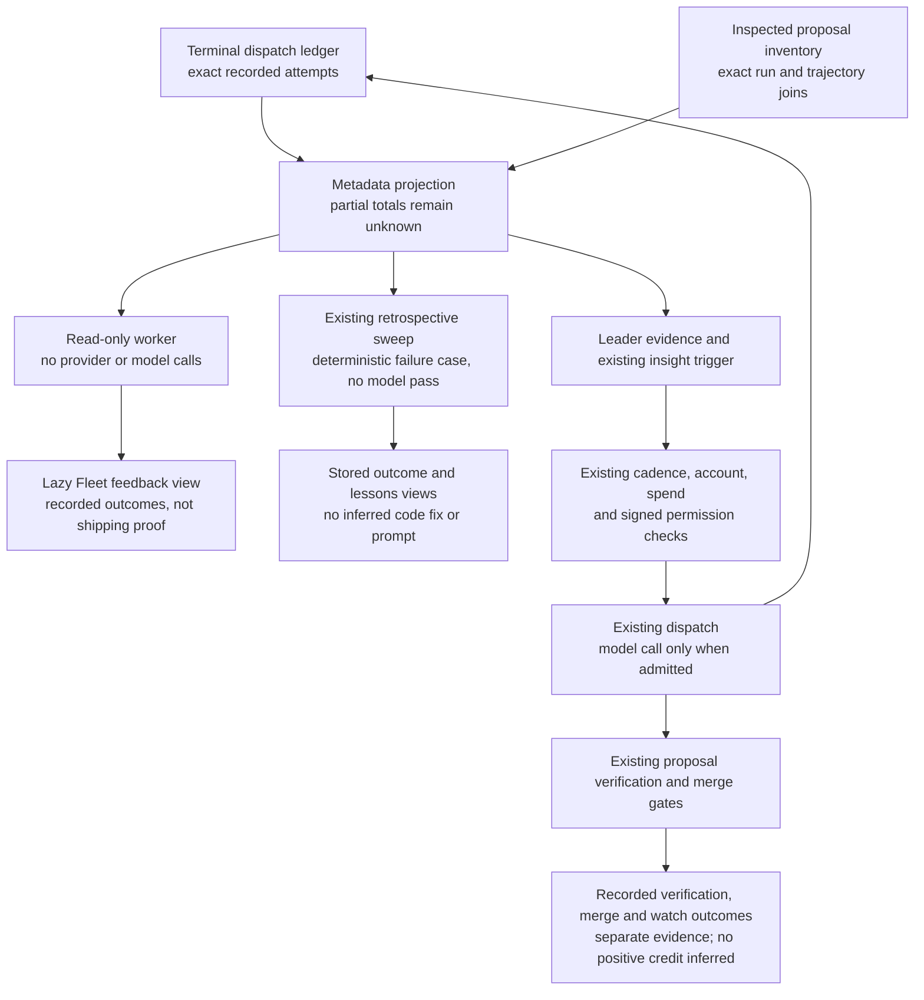

# Recorded fleet execution feedback

Execution feedback connects terminal producer records to the existing retrospective sweep and Leader evidence. Reading it runs no provider, model, repair, or dispatch. It does not change permissions, spend, account readiness, or routing credit.

The projection separates proposal production, producer failure, cancellation, refusal, empty diff, disabled proposal filing, and unknown outcome. A produced proposal is **not** a verified change, merge, successful deployment, or beneficial production outcome. Those stages remain recorded by their existing proposal and authority readers.

Only current writer envelopes with matching attempt, run, trajectory, outcome, and summary count. Identical replays count once. Conflicting finals for the same attempt are withheld rather than resolved by arrival order. Legacy envelopes, unreadable files, truncated reads, and invalid or future timestamps make exact totals unknown. `observedCounts` remains a qualified lower bound; a missing store is not a measured zero.

The metadata view contains opaque case hashes and finite outcome fields. Raw prompts, errors, repository paths, account identities, run IDs, and tool payloads are excluded. Authorized internal callers can resolve a case through `lookupExecutionFeedback` to its real run and attempt trajectory. This is recorded local correlation, not signed authority or proof of provider identity.

The retrospective sweep records an observed engine, sandbox, or capture failure only when no proposal was recorded and the proposal inventory was completely inspected. A late proposal must match **both** run and attempt trajectory to suppress this no-proposal learning path. Partial proposal reads hold it. An already saved failure remains a historical observation; distinct later verification or merge outcomes retain their own records.

These failure retros contain no inferred code or authentication diagnosis, no sharper prompt, and no knowledge candidates. They skip the optional model and Jev refinement passes. The existing stable retrospective ID, sweep single-flight, private storage, retention, and review flow handle replay and persistence.

The Leader receives aggregate metadata as untrusted evidence. Failed attempts after its last run can use the existing insight trigger. Daily preferences, retries, hash coalescing, signed authority, account and spend admission still apply. Trigger and prompt collection share one bounded read in a tick; source failure remains unknown. No separate paid wake-up is added.

The worker reader uses a fixed seven-day window and existing bounded inspection-only dispatch/inbox readers. A retrospective sweep uses its existing thirty-day window. Coverage reflects those windows and reader byte/file/row limits; it does not claim whole-history completeness. Usage, tokens, duration, causal repair success, and positive post-merge credit are not synthesized by this projection.



Opening the view does not traverse the dispatch path. The Leader may use recorded evidence in an already permitted run; neither a retrospective nor an observed failure bypasses admission or proves that a repair worked.


## Inspect a recorded execution case

The authorized case-detail GET is `/api/verse/fleet/live/feedback/cases/:caseId`, using the opaque `h:…:…:…:…` identity returned by the summary. It accepts no caller-selected repository, history window, file path or URL. A cold read returns a warming state immediately while the existing bounded read worker inspects local evidence. The last selected case can remain explicitly stale while it refreshes; source failures remain unavailable. Reading a case starts no model, provider request, repair, merge or deployment.

The timeline joins a real terminal attempt to proposals only by exact run and trajectory. Local verification reports its actual verification time and remains unbound when the diff bytes/hash or base evidence is missing or mismatched. An actual readable run and proposal can link to their existing local views. Validated repository and positive PR-number records produce canonical GitHub PR links. Recorded authority-ledger landings are distinguished from persistence-authenticated local or host realized-merge receipts; a broken chain cannot establish a ledger merge or revert. Post-merge CI and local suite results remain separate, so `unknown` CI plus a passing suite is not reported as successful GitHub checks.

Partial proposal history, unreadable ledger sources, malformed records and conflicting bindings have independent coverage. Missing timestamps stay unknown; the reading time never becomes a verification or merge time. The shared worker's existing timeout and heap boundaries contain expensive history inspection; these are read limits, not account or work quotas. No new case-count truncation is introduced. Detail responses project only closed outcome fields and fixed navigation links, excluding prompts, diffs, raw errors, account identities, grant IDs and repository paths.

A merge or green post-merge observation is not shipping proof. Case details explicitly say release/deployment is not recorded. Current durable records also lack workflow/check-run IDs, so this view neither fabricates GitHub Actions links nor fetches them when opened.

## Inspect routing evidence in the CLI

Run `phm telemetry feedback` (or `npm run dev -- telemetry feedback --json`
from source). Both formats expose the same four sections without emitting a
synthetic span or contacting a provider:

| Section | What it establishes |
| --- | --- |
| `observedOutcomes` | Recorded terminal producer counts and observed sample size; a produced proposal is not verified delivery |
| `sampleCoverage` | Original window, latest observation, source health, exact versus lower-bound counts, and excluded/conflicting records |
| `selectionRationale` | Unavailable in this projection; inspect the original decision for eligibility, preferences, funding and tie-breaking inputs |
| `inferredPerformance` | Unmeasured, with a null estimate; no causal benefit or account/model/task ranking is inferred |

A healthy bounded read can have only one attempt. Exact counting does not make
that sample representative. If the newest observation is six days old, its
`observedThrough` stays six days old when inspected today. Conflicting finals
remain excluded with `conflictingAttempts` reported; they are not silently
counted as failures or resolved in favor of success. Missing sources retain null
exact totals, even when the observed lower bounds contain only zeros. Proposal
inventory coverage is separate from terminal-event completeness.

Selection describes why a resource was chosen given the inputs available at
that time. An observed failure after selection does not establish that selection
caused the failure, that another model would succeed, or that a later repair
helped. Provider aggregates also mix task difficulty, harnesses, account access
and selection policies. Comparable task populations and an appropriate controlled
comparison would be needed to support a performance or causal claim.

### Runnable regression examples

The following dependency-free Node tests exercise the CLI report formatter with
sparse, old, conflicting and missing evidence. Extract this fence to a temporary
`.mjs` file and run `node --import tsx --test <file>` from the repository root,
with a temporary `HOME`. The fixtures are metadata only.

```js
// telemetry-feedback-regression
import assert from 'node:assert/strict';
import test from 'node:test';
import { pathToFileURL } from 'node:url';
import { execFileSync } from 'node:child_process';
import { mkdtempSync } from 'node:fs';
import { tmpdir } from 'node:os';
import { join } from 'node:path';
const { telemetryFeedbackReport } = await import(pathToFileURL(`${process.cwd()}/src/cli/telemetry.ts`));
const counts = { 'producer-succeeded': 1, failed: 0, cancelled: 0, refused: 0,
  'empty-diff': 0, disabled: 0, unknown: 0 };
const fixture = () => ({ schemaVersion: 1, sourceState: 'healthy', complete: true,
  window: { since: '2026-10-21T00:00:00.000Z', through: '2026-10-28T00:00:00.000Z' },
  observedThrough: '2026-10-22T00:00:00.000Z', counts: { ...counts },
  observedCounts: { ...counts }, cases: [], digest: 'fixture',
  coverage: { legacyRows: 0, invalidAttempts: 0, conflictingAttempts: 0,
    duplicateRows: 0, invalidTimestamps: 0, proposalSource: 'healthy' } });
function limits(report) {
  assert.equal(report.selectionRationale.status, 'unavailable');
  assert.equal(report.inferredPerformance.status, 'unmeasured');
  assert.equal(report.inferredPerformance.estimate, null);
  assert.match(report.inferredPerformance.meaning, /neither a model ranking nor a causal/);
  assert.match(report.observedOutcomes.meaning, /does not establish verification, merge or deployment/);
  assert.equal('successRate' in report.observedOutcomes, false);
}
test('one recorded proposal gives a sample count without a performance estimate', () => {
  const report = telemetryFeedbackReport(fixture());
  assert.equal(report.observedOutcomes.sampleSize, 1);
  assert.deepEqual(report.observedOutcomes.counts, counts);
  assert.match(report.sampleCoverage.countBasis, /exact within bounded/);
  limits(report);
});
test('inspection retains old observation time and the original bounded window', () => {
  const view = fixture();
  const report = telemetryFeedbackReport(view);
  assert.equal(report.sampleCoverage.observedThrough, '2026-10-22T00:00:00.000Z');
  assert.deepEqual(report.sampleCoverage.window, view.window);
  assert.match(report.sampleCoverage.meaning, /does not refresh observations/);
  limits(report);
});
test('conflicting evidence preserves lower bounds and independent proposal coverage', () => {
  const view = fixture();
  view.sourceState = 'degraded'; view.complete = false; view.counts = null;
  view.observedCounts.failed = 1;
  view.coverage.conflictingAttempts = 2; view.coverage.proposalSource = 'degraded';
  const report = telemetryFeedbackReport(view);
  assert.equal(report.observedOutcomes.sampleSize, 2);
  assert.equal(report.observedOutcomes.counts, null);
  assert.deepEqual(report.observedOutcomes.observedCounts, view.observedCounts);
  assert.equal(report.sampleCoverage.conflictingAttempts, 2);
  assert.equal(report.sampleCoverage.proposalSource, 'degraded');
  assert.equal(report.sampleCoverage.complete, false);
  assert.match(report.sampleCoverage.countBasis, /exact totals unknown/);
  limits(report);
});
test('a missing source is unknown even with zero observed records', () => {
  const view = fixture();
  view.sourceState = 'missing'; view.complete = false; view.counts = null;
  view.observedThrough = null; view.observedCounts['producer-succeeded'] = 0;
  const report = telemetryFeedbackReport(view);
  assert.equal(report.observedOutcomes.sampleSize, 0);
  assert.equal(report.observedOutcomes.counts, null);
  assert.equal(report.sampleCoverage.sourceState, 'missing');
  assert.equal(report.sampleCoverage.observedThrough, null);
  assert.match(report.sampleCoverage.meaning, /unknown, not zero/);
  limits(report);
});
test('feedback CLI emits qualified JSON and text without configured telemetry', () => {
  const home = mkdtempSync(join(tmpdir(), 'feedback-cli-'));
  const run = (args) => execFileSync(process.execPath,
    ['--import', 'tsx', '--input-type=module', '-e',
      `import { cmdTelemetry } from './src/cli/telemetry.ts'; process.exitCode = await cmdTelemetry(${JSON.stringify(args)});`],
    { cwd: process.cwd(), env: { ...process.env, HOME: home }, encoding: 'utf8' });
  const report = JSON.parse(run(['feedback', '--json']));
  assert.equal(report.observedOutcomes.counts, null);
  assert.equal(report.sampleCoverage.sourceState, 'missing');
  limits(report);
  const text = run(['feedback']);
  for (const section of ['observedOutcomes', 'sampleCoverage', 'selectionRationale', 'inferredPerformance']) {
    assert.ok(text.includes(`${section}:`));
  }
  assert.match(text, /unmeasured/);
});
```
