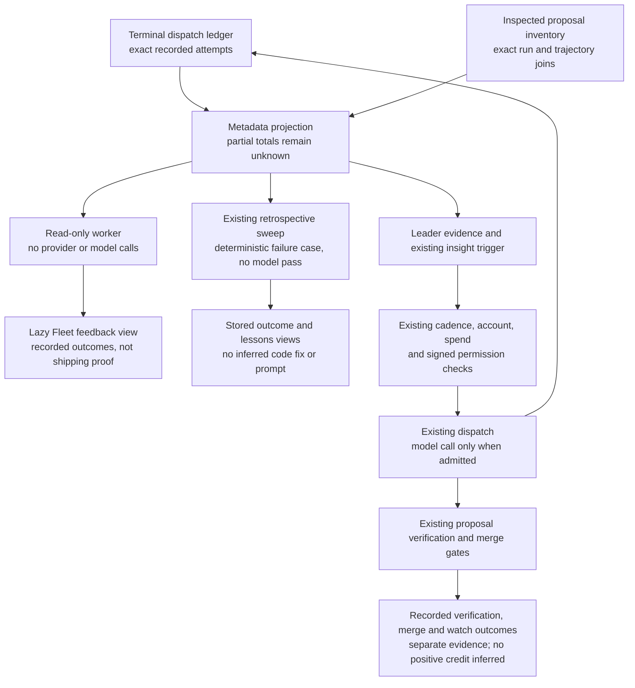

# Recorded fleet execution feedback

Execution feedback connects terminal producer records to the existing retrospective sweep and Leader evidence. Reading it runs no provider, model, repair, or dispatch. It does not change permissions, spend, account readiness, or routing credit.

The projection separates proposal production, producer failure, cancellation, refusal, empty diff, disabled proposal filing, and unknown outcome. A produced proposal is **not** a verified change, merge, successful deployment, or beneficial production outcome. Those stages remain recorded by their existing proposal and authority readers.

Only current writer envelopes with matching attempt, run, trajectory, outcome, and summary count. Identical replays count once. Conflicting finals for the same attempt are withheld rather than resolved by arrival order. Legacy envelopes, unreadable files, truncated reads, and invalid or future timestamps make exact totals unknown. `observedCounts` remains a qualified lower bound; a missing store is not a measured zero.

The metadata view contains opaque case hashes and finite outcome fields. Raw prompts, errors, repository paths, account identities, run IDs, and tool payloads are excluded. Authorized internal callers can resolve a case through `lookupExecutionFeedback` to its real run and attempt trajectory. This is recorded local correlation, not signed authority or proof of provider identity.

The retrospective sweep records an observed engine, sandbox, or capture failure only when no proposal was recorded and the proposal inventory was completely inspected. A late proposal must match **both** run and attempt trajectory to suppress this no-proposal learning path. Partial proposal reads hold it. An already saved failure remains a historical observation; distinct later verification or merge outcomes retain their own records.

These failure retros contain no inferred code or authentication diagnosis, no sharper prompt, and no knowledge candidates. They skip the optional model and Jev refinement passes. The existing stable retrospective ID, sweep single-flight, private storage, retention, and review flow handle replay and persistence.

The Leader receives aggregate metadata as untrusted evidence. Failed attempts after its last run can use the existing insight trigger. Daily preferences, retries, hash coalescing, signed authority, account and spend admission still apply. Trigger and prompt collection share one bounded read in a tick; source failure remains unknown. No separate paid wake-up is added.

The worker reader uses a fixed seven-day window and existing bounded inspection-only dispatch/inbox readers. A retrospective sweep uses its existing thirty-day window. Coverage reflects those windows and reader byte/file/row limits; it does not claim whole-history completeness. Usage, tokens, duration, causal repair success, and positive post-merge credit are not synthesized by this projection.



Opening the view does not traverse the dispatch path. The Leader may use recorded evidence in an already permitted run; neither a retrospective nor an observed failure bypasses admission or proves that a repair worked.


## Inspect a recorded execution case

The authorized case-detail GET is `/api/verse/fleet/live/feedback/cases/:caseId`, using the opaque `h:…:…:…:…` identity returned by the summary. It accepts no caller-selected repository, history window, file path or URL. A cold read returns a warming state immediately while the existing bounded read worker inspects local evidence. The last selected case can remain explicitly stale while it refreshes; source failures remain unavailable. Reading a case starts no model, provider request, repair, merge or deployment.

The timeline joins a real terminal attempt to proposals only by exact run and trajectory. Local verification reports its actual verification time and remains unbound when the diff bytes/hash or base evidence is missing or mismatched. An actual readable run and proposal can link to their existing local views. Validated repository and positive PR-number records produce canonical GitHub PR links. Recorded authority-ledger landings are distinguished from persistence-authenticated local or host realized-merge receipts; a broken chain cannot establish a ledger merge or revert. Post-merge CI and local suite results remain separate, so `unknown` CI plus a passing suite is not reported as successful GitHub checks.

Partial proposal history, unreadable ledger sources, malformed records and conflicting bindings have independent coverage. Missing timestamps stay unknown; the reading time never becomes a verification or merge time. The shared worker's existing timeout and heap boundaries contain expensive history inspection; these are read limits, not account or work quotas. No new case-count truncation is introduced. Detail responses project only closed outcome fields and fixed navigation links, excluding prompts, diffs, raw errors, account identities, grant IDs and repository paths.

A merge or green post-merge observation is not shipping proof. Case details explicitly say release/deployment is not recorded. Current durable records also lack workflow/check-run IDs, so this view neither fabricates GitHub Actions links nor fetches them when opened.

## Routing observations in the CLI

`phm models routing [--json]` and `phm telemetry routing [--json]` inspect the
same local evidence without probing providers, measuring models or dispatching
work. They do not require telemetry configuration. Task fit shows candidate and
exclusion counts from the newest valid shadow decision in the bounded 50-record
read. This is eligibility for that recorded request, not a fresh recommendation,
measured model quality or proof that a candidate actually ran. No account IDs or
raw decision text are printed.

Evidence up to fifteen minutes old is `observed`; older evidence is `stale`.
Missing records are `absent`, never measured zeros. Unreadable sources or invalid
or future timestamps are `unavailable`. Feedback retains its seven-day window,
source state, completeness and lower-bound counts independently of freshness.
Feedback is fleet-wide and is not attributed to a model or to a routing choice.
Comparable latency is `absent`: these sources contain no account/model/task/version
latency measurements. Missing latency did not influence a choice. Neither stale
nor current feedback establishes a causal contribution to a recorded choice.
An inspection failure returns exit code 1; absent or stale evidence alone does
not fail the command.

### Scoped regression check

The following executable regression uses only a temporary home. Run the block
with `HOME=$(mktemp -d) node --import tsx --input-type=module` from the repository
root. It checks observed, stale and absent evidence through both command views,
as well as invalid timestamps and missing latency. No real account data is read.

```js
import assert from 'node:assert/strict';
import { cmdModels } from './src/cli/models.ts';
import { cmdTelemetry, routingEvidenceAge } from './src/cli/telemetry.ts';
import { recordShadowDecision } from './src/core/routing/budget-store.ts';
const now = Date.now();
assert.equal(routingEvidenceAge(null, now), 'absent');
assert.equal(routingEvidenceAge(new Date(now).toISOString(), now), 'observed');
assert.equal(routingEvidenceAge(new Date(now - 900001).toISOString(), now), 'stale');
assert.equal(routingEvidenceAge('invalid', now), 'unavailable');
assert.equal(routingEvidenceAge(new Date(now + 1).toISOString(), now), 'unavailable');
async function inspect(command) {
  let output = '';
  const write = process.stdout.write;
  process.stdout.write = chunk => { output += chunk; return true; };
  try { assert.equal(await command(['routing', '--json']), 0); }
  finally { process.stdout.write = write; }
  return JSON.parse(output);
}
const absent = await inspect(cmdModels);
assert.equal(absent.taskFit.state, 'absent');
assert.equal(absent.taskFit.candidates, null);
assert.equal(absent.feedback.state, 'absent');
for (const [age, state] of [[1800000, 'stale'], [0, 'observed']]) {
  assert.equal(recordShadowDecision({
    source: 'test', now: new Date(now - age),
    request: { task: 'code', difficulty: 'medium', autonomous: true },
    decision: { seatId: 'private-seat', candidates: ['private-seat'],
      exclusions: [], why: 'private explanation', mode: 'balanced' },
  }), true);
  for (const command of [cmdModels, cmdTelemetry]) {
    const view = await inspect(command);
    assert.equal(view.taskFit.state, state);
    assert.equal(view.taskFit.candidates, 1);
    assert.equal(view.latency.state, 'absent');
    assert.equal(view.latency.milliseconds, null);
    assert.match(view.latency.explanation, /Missing latency did not influence/);
    assert.doesNotMatch(JSON.stringify(view), /private-seat|private explanation/);
    const lines = [];
    const log = console.log;
    console.log = (...args) => lines.push(args.join(' '));
    try { assert.equal(await command(['routing']), 0); }
    finally { console.log = log; }
    assert.match(lines.join('\n'), new RegExp('Task fit: ' + state));
    assert.match(lines.join('\n'), /Latency: absent/);
    assert.match(lines.join('\n'), /absent evidence is not a measured zero/);
  }
}
console.log('Routing observation regression passed (5 age cases, 9 CLI views).');
```
