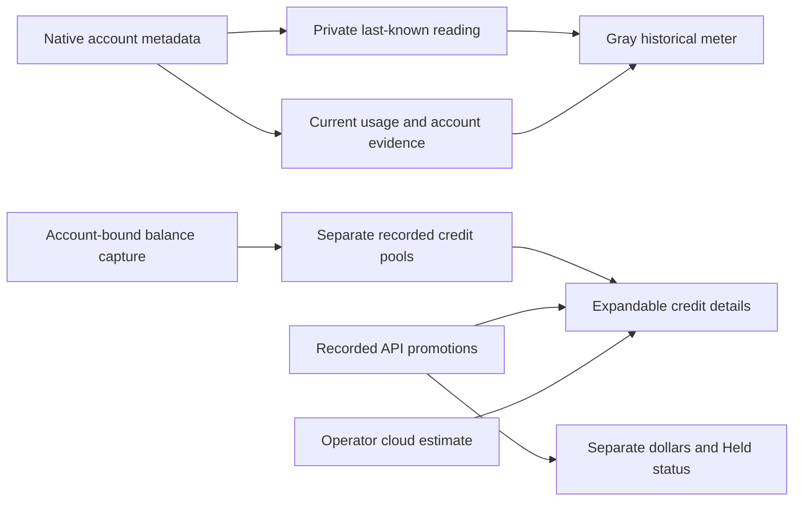

# Resource readings and credit balances

## Lane allowance cards

The Resources drawer reads `GET /api/usage/lanes` to show each lane's recorded
allowance, remaining amount, reset countdown and observation age alongside the
router's burn, balanced or preserve posture. Missing readings remain unknown;
stale readings keep their last values with a stale label, not fresh headroom.

Each card names its lane beside the provider mark and draws the shared
usage-window bar. The solid share is measured use. When the router's posture
receipt for the same window projects allowance left over, that share is
outlined in amber and the stretch between is drawn lighter: on course to be
used. When the measured burn reaches the limit before the reset, the bar turns
amber and the card gives the time it runs out. A reading that reports where
its window began (`windowStart` on the row) adds a mark for the time gone and
a line comparing use with an even spend. A stale reading, an unknown reset or
a reset that has passed draws the last measured share and projects nothing. A
lane with no usable reading keeps its card with a hatched bar and the reason,
never 0%. The reset shows as a countdown and a local time. The heading counts
the lanes measured. A refresh keeps the cards on screen; if it fails they stay,
under a line giving the time of the read they came from.

History sparklines use recorded samples. Devin cards separate weekly ACUs and
in-flight reservations from the Lightning/Flash preview expiry; absent preview
pricing evidence is unknown, never assumed free. API USD credit pools are
tagged `api-credit`; local or unrecognized router cost classes stay unknown.

## Lane history

`phm usage history --lane devin --json` reads full-resolution measured points;
`--lane` accepts an allowance id, dispatch lane or sensor lane. `--runs-dir <abs>`
selects another runs directory. Missing history is an empty successful result.
The private `state/resource-live-history.json` keeps seven days, up to 2016 points
per allowance, skipping observations less than five minutes apart. Unverified
polls add nothing. Devin weekly readings feed the `devin` allowance automatically.
The Resources rail selects the last real point per hour and leaves gaps unconnected.
Burn requires at least fifteen minutes of contiguous measurements within six hours
in one reset window; a decrease or gap over thirty minutes breaks the window.

Phantom keeps each account's subscription windows, native credit units, captured dollar balances, and operator estimates separate. The resource sidebar uses the same live capacity model as the resource drawer. Refreshing a reading does not renew its original observation or expiration.

Summary counts describe accounts **with current usage** and accounts whose usage is
**unconfirmed**. A fresh reached-limit reading still counts as current evidence;
it does not imply available allowance. Sign-in, recorded credits and historical
readings alone do not count as current usage. Chat and Fleet readiness appear
separately in each account card.

Each usage window on an account card is drawn on the bar the resource boards
share (`components/primitives/WindowBar.tsx`). The fill is the share used. A
hatched band at the end of the binding window is the reserve kept for you, and
the line under the bar names it ("40% kept for you"). A flagged limit fills the
bar in red and shows "limit reached" with no percentage. A window with no
reading, or with a reading that is no longer current, is a hatched track.

A mark across the bar shows how much of the window's time has gone, and the
line under it says so in words with how far use sits from an even spend ("71%
of the window gone · use is 9 points behind an even spend"). The mark needs the
window's start, which comes from the reset provenance on the seat
(`GET /api/verse/seats`, the same provenance `GET /api/verse/accounts` gives the
Usage board): the provider's own period start, or seven days before a reset
the server qualified as weekly. A window without that provenance has no mark
and no line; the start is never guessed from the window's name.

Connect native CLI accounts for subscription work, configure API resources separately,
or run models on your own hardware. Routing is provider-neutral: an account's
supported execution path, model capabilities and current evidence determine which
roles it can run. A company name alone does not qualify a Leader, Manager or worker.
See [work modes and routing](AUTOMATIC-OUTCOMES.md).

On startup, a validated private reading cache can show last-known usage before native metadata collection completes. Gray meters say **last** and retain the original reading date. Fresh native readings replace them. Historical windows never supply live capacity, account authentication, usable-again times, routing eligibility, or reset spend-down pressure. An account switch or sign-out suppresses the previous account's values.



The private cache binds readings to the account, selected native profile, and a checked local identity. An unchanged local credential-file epoch can qualify historical association after restart; it does not prove a current provider login. Original timestamps remain unchanged. Bulk cache writes and file synchronization run asynchronously. The final ownership, account-generation, target-file, and temporary-file checks precede a short metadata commit without an intervening JavaScript yield. Files remain private, and a malformed or replaced cache is unavailable rather than silently overwritten.

## Different kinds of capacity

| Reading | Display | Meaning for autonomous scheduling |
| --- | --- | --- |
| Current subscription window | Native percentage and reported reset | Existing account, permission, and subscription admission apply |
| Historical subscription window | Gray dated reading | Display only; does not authorize work |
| Native Codex credit balance | Rounded recorded credit units and a labeled dollar reference when supported | Separate from the subscription; a balance does not authorize autonomous credit spending |
| Captured Claude cloud gift | Rounded last-recorded dollars, cloud scope, and verified expiration if recorded | Historical balance evidence; capture does not activate gift spending |
| Captured purchased usage credits | Separate last-recorded dollars and expiration, if known | Does not acquire subscription reset urgency |
| Captured Claude API promotion | Separate recorded API dollars and verified date precision | Advisory only; billing, execution binding and signed API authority must be commissioned before spending |
| Operator cloud estimate | **Cloud estimate**, with its estimate qualifier | Separate from a provider-reported wallet or captured balance |
| Local model | Runtime readiness, host CPU/RAM and scoped speed readings | Uses this computer's hardware, not a provider subscription allowance |
| Grok Bot profile | Separate identity; unknown allowance and reset until verified | Grok Build quota does not establish Bot capacity or connect Bot execution |

Dollar references are not invoices, purchased-credit prices, or attributed task costs. Subscription percentages are not token counts. Different accounts remain independent, including accounts from the same provider. No account-count truncation is introduced by these views.

In the left rail each of these rows draws the same bar as the boards
(`components/primitives/WindowBar.tsx`), not a battery: the fill is the share
**used**, left to right, so the rail and the Resources drawer read the same
way. An account row draws its binding window, with the reserve hatched at the
window's end and a mark for the time gone where the seat reports when the
window began; the hover card carries the same reading in words. A row with
nothing left is a full red bar with no percentage. No reading, or a reading
that is no longer current, is a hatched bar whatever it last said; the dated
value stays in the text beside it. The Devin tracked budget draws reported use
solid and the exposure held for running sessions lighter after it, so held is
never read as used. The cloud estimate draws the share of the estimate spent.
Local models are not metered and get a readiness dot instead of a bar. The
collapsed rail draws the bar as a thin rule under each provider mark.

## Grok Build and Grok Bot

Grok Build's native account reading, Grok Bot's included allowance and xAI API
credits are separate resources. The native CLI reports a consumer billing
window and reset, which can be Build-specific or shared across supported
consumer use. Usage labels distinguish these scopes and their reported weekly
or monthly periods. Phantom does not copy the observation into a Bot profile
or API wallet.

Grok's Usage page can show separate weekly meters for Build/shared consumer
use and Grok Bot, with independent resets. Verify the account behind each
meter; subscription linkage alone does not establish that billing identity.

[Cursor's Grok Bot plans](https://cursor.com/help/grok-bot/plans) describe Bot
eligibility and on-demand billing, not the billing account behind a particular
Grok usage-page meter. A linked SuperGrok plan grants Bot access without
stacking another allowance on top of an existing eligible Cursor plan.
On-demand usage is a separate paid pool; its monthly spending limit is not a
hard stop during an active run.

Current proactive profiles record the intended Bot account and responsibilities,
not a verified remaining allowance or reset. Phantom has not qualified a native
Bot quota reader or autonomous Bot dispatch. Unknown Bot usage stays unknown;
saving a profile never enables spending. See [proactive profiles](VERSE.md#proactive-agent-profiles).

Track each account and product independently. Build allowance cannot substitute
for Bot allowance, even when one subscription gives access to both. Purchased
credits and Bot on-demand billing are not included allowance to spend before a reset.

## Local hardware and task speed

Expand the local resource to inspect host CPU, RAM, runtime-reported model
residency and recorded task speed. These measurements have different meanings:

The fleet also uses complete, fresh runtime slot activity to size new local
work. Total serving capacity and currently available slots are separate facts.
Existing experiment reservations and observed occupancy are counted once;
new experiments reserve their slots after the observation. Unknown or stale
activity retains the existing configured-capacity policy. CPU, RAM and warm
decoder speed do not impose additional routing limits.

- **Host CPU** is busy time across all cores over the displayed sampling interval.
  It averages activity since the previous sample. The first reading after the
  drawer was closed or the window hidden can span that entire gap; visible
  polling normally samples every 30 seconds. RAM is sampled at the new reading,
  rather than averaged over the CPU interval.
- **Host RAM** is total and OS free memory. Free memory is not macOS memory
  pressure or a safe model-allocation limit; model residency is reported separately.
- **Task speed** is recorded output tokens divided by end-to-end turn time,
  bound to the selected resource, model, context and endpoint. It includes tool
  and harness time; it is not decoder speed. Failed or cancelled turns do not
  become successful speed observations. Warm measurements retain their warm scope.

Input, output, cache-read and cache-write counts each require explicitly reported,
valid token evidence. Missing fields and older events without that evidence stay
unknown; a normalized zero does not prove zero usage. A turn can report output
tokens while its input or cache counts remain unknown. Only qualified output
counts and a completed turn duration establish its end-to-end token rate.

Missing measurements remain unknown, and visible ages retain the original
observation time. The router uses reported allowance, task/context fit, qualified
funding and explicit preferences. Unqualified provider-wide latency remains
diagnostic. Sidebar CPU, RAM and exact-model task-speed readings are currently
descriptive; they do not yet drive model selection or concurrency.

Context windows also carry provenance: a server-reported allocation, model
catalog value and configured/default estimate are different evidence. Inspect
the context tooltip and [context guide](VERSE-CONTEXT.md), rather than treating
every displayed window as a current per-agent allocation. Total serving context
and per-slot context are distinct.

## Routing tiers and roles

Elite, Fast and Free remain legacy display groups, not measurements of model
quality, speed or price. Default shared seat selection, Leader model-variant
selection and the chat Auto adviser do not use inferred provider or model-family
tiers as quality or cost ranks. They rank eligible resources by current headroom
and independent funding category, preserving configured runnable model order
when the evidence ties. Unknown quality and comparable latency stay unknown;
an unspecified funding category is neutral, not a zero-dollar cost.

Explicit model selections, pins and recorded operator preferences remain distinct
from catalog labels. A caller can supply an explicit invocation tier preference;
automatic catalog metadata does not create one. Provider-wide ship rates and
latency averages remain diagnostics, rather than exact account/model/task
measurements. A Devin SWE name does not prove included funding. Account-bound
native pricing and execution checks still apply.

Local coding dispatch binds the observed local seat to a tool-capable runtime,
such as llama-server or local-coder. The builtin planning loop cannot consume
that coding lane; if no capable local adapter is available, another eligible
account can run the work. Otherwise, the item waits.

This scope does not replace every legacy worker selection policy or establish
measured-quality learning. See the shared [seat router](../src/core/routing/router.ts)
and [Auto adviser](../src/core/verse/multimodel/advisor.ts).

Leader, Manager and worker eligibility is checked separately through the
available account-bound adapter, context, current funding evidence and authority.
Supported Claude, Codex, Grok, Devin and tool-capable local resources can serve
eligible roles; a saved connection or tier label alone does not qualify a run.

## Credit details

The visible resource bar and the open **Credit balances** disclosure share one recorded-balance query cache. The bar shows API promotion records separately from subscription meters; the disclosure shows each pool in detail. The authorized GET is `/api/verse/resources/credit-pools`; it accepts no query parameters, provider command, file path, or caller-selected identity. A cold request returns `warming` while the existing bounded worker reads private evidence. Stale and unavailable readings retain their qualifiers. The HTTP fast path uses existing in-memory collector status and identity snapshots.

Credit records project only their account ID, pool kind, exact amount, original capture time, scope, source, and expiration. Private identity digests, credential paths, and collection generations do not enter the response. Native account evidence verifies the association, not a manually captured monetary balance. Internal capture requires paired fresh native witnesses and a matching generation at publication. A changed or unknown identity hides the amounts. This read surface neither captures new balances nor changes provider billing.

The endpoint reads fixed local stores. Opening it does not start a model, provider probe, cloud scheduler, or dispatch. Missing records mean **unknown**, not zero dollars. A recorded deadline passing does not establish a newly refreshed balance or prove that a provider actually expired a grant.

In the Resources drawer the open disclosure draws one card per recorded balance: the provider mark beside the kind of balance, the account, the recorded figure, and the same usage bar the lane allowance and pool cards use. The bar's filled share is the part of the recorded grant that was gone when the balance was captured, and a sentence under it says so ("75% of the recorded grant was gone at capture"); a subscription window draws the share recorded as used. The share comes only from the two recorded figures. A balance whose grant or total is not recorded gets no bar and the line "No total is recorded, so the share spent is unknown"; a balance that is unknown, or hidden because the account is not verified, keeps its card with a hatched bar and no value. Each card counts down to its recorded deadline beside the local time, gives the age of the capture, and draws the bar faint once the deadline has passed. An API promotion counts down to the time Phantom stops new API work, and says "stopped" after it. Above the cards one line counts the balances that carry a figure out of those listed and names the first credit deadline ahead; a subscription reset is not counted as a credit deadline, and balances are never added together.

## Every-resource usage aggregate

The console's **Every resource** panel (desktop Usage section and mobile Fleet screen) reads one authorized GET, `/api/verse/usage-resources`, accepting no query parameters or mutations. It returns the twelve fixed operator resources — Ultra (Cursor + Grok pool), Claude Max, claude-api gift, claude-api monthly, codex-cmp, codex-personal, Devin, zai, agy, Gemini (Workspace), local and Stacksync — each with used, limit, unit, resets-at, source and as-of, or an explicit state: `ok`, `no-reading` (a reader ran but measured nothing), `no-reader` (nothing in the repo reads that resource yet) or `unavailable` (the read failed, errored, or beat its deadline).

Each resource is one `UsageResourceReader` in `src/core/usage/resource-usage.ts`: a small function returning the shared `UsageResourceReading` shape, or `null`. Adding a reader for an uncovered pool is a one-function change. Reader returns are boundary-checked — only finite non-negative amounts, ISO instants, and bounded printable source labels reach the wire; a malformed or oversized return degrades to `unavailable`. Reader failures are states, never thrown errors, and provider error text is never echoed. A resource with no measured value reports nulls, never a fabricated percentage or limit.

The same read carries the scheduler's pace snapshot, which the Resources drawer draws under **Usage pace**: a headline naming the pool that takes the next job, one strip showing how new ordinary work is split between the pools with room, and a row per pool in the scheduler's rank order. Each row has the provider mark, the verdict (**Send work here**, **On pace**, **Top priority only** or **Unknown**), the pool's share of new work, and the shared usage-window bar: used so far, more by the reset at the measured burn, and the share left unused. A pool that runs dry before its reset draws its bar in amber and takes no ordinary work. A pool with no reading keeps its row with a hatched bar and the reason, and a pool with a usage reading but no burn rate draws only the share used. A report older than two minutes is not read as current: every row then reads unknown and the section says how old the report is. The shares are the ones this command prints:

```bash
phm fleet pools --json
```

## Claude API promotional grants

The resource bar and expandable credit view can show a private, verified API grant observation separately from Claude's subscription and cloud-session credits. A single promotion shows last-recorded dollars and **Held**; several records show their count without adding possibly overlapping history. On a cold local read, the bar checks every two seconds for at most thirty seconds, then returns to its regular fifteen-second cadence. Hidden surfaces stop polling. Money is stored as exact integer microdollars and displayed with two significant figures, including the recorded amount in hover details. Storage and admission arithmetic retain the exact values. Its asynchronous local read does not wait for the subscription worker or request billing credentials. API organization, workspace and credential digests remain private. Windows currently reports this new read unavailable until asynchronous private-file ACL verification is supported.

A provider-reported UTC expiry date is displayed as a date. When no exact expiry instant is supplied, Phantom conservatively stops new admissions at the **start** of that UTC date. This is Phantom's policy, not a claim about the provider's expiration time. Unknown balances or dates block admission. A future billing cycle never creates a synthetic new grant.

The internal first-party Messages adapter requires fresh verified prepaid, non-invoiced, promotion-only funding with auto-reload off, no purchased or other paid funding, a matching execution credential binding, and explicit signed metered authority. Each request reserves a bounded worst-case dollar amount before credential resolution or contact. Unconfirmed contact retains its reservation; only verified usage settles actual cost. It neither creates credentials nor changes billing.

The existing subscription standing grant does **not** enable this distinct API lane. The router keeps it off, and this read-only view says **Automatic use held** until the native authority and source-owned billing proof reader are commissioned. Manually recording a grant cannot enable it. See [reset-aware scheduling](RESET-AWARE-SCHEDULING.md#api-promotions).

To record captured promotional-credit history locally, prepare a JSON observation in the existing [`claude-api-promotion-history` schema](../src/core/resources/claude-api-grant-types.ts), then run:

```sh
phm resources claude-promotion record --observation /absolute/path/history.json --json
```

Keep the original `capturedAt`, the capture's SHA-256 `evidenceDigest`, and the reported integer-microdollar amounts. Set `binding` and `cycleId` to `null`. For a UTC expiry date without an exact instant, use `expiry: {"precision":"date","date":"YYYY-MM-DD","timezone":"UTC","instant":null}`; unknown expiry or amounts stay unknown. The command validates the local schema, not the authenticity of billing evidence, and returns **Held**. It writes only the existing private history store, creates no credentials or financial authority, and makes no provider request. `--accounts-root` can select the same private root configured for the desktop; otherwise the configured accounts root is used. An identical observation ID is idempotent; a conflicting ID, unsafe file or busy store is refused without replacing existing history.

For recorded attempt, verification, and GitHub outcomes, see [execution feedback](EXECUTION-FEEDBACK.md).

## Publish subscription capacity

Run `phm capacity publish --json` on each node to refresh its local capacity
snapshot once with that node's own local CLI authentication. Only usage metadata
is published; credentials stay local. Exit 0 means published or already fresh,
1 means unavailable (follow the returned recovery instruction), and 2 means bad
arguments or configuration. Unknown usage remains ineligible; publishing does
not guarantee a seat qualifies. Resident daemons start the publisher at startup
and check every minute outside tick dispatch, sampling at most every five minutes.
`ASHLR_DAEMON_CAPACITY_PUBLISHER=0` disables automatic daemon publication.

The Resources rail reads `<runs>/state/resource-live.json`, not `capacity.json`.
Each resident publisher cycle also refreshes that sidecar with bounded sources.
Evidence order is official API reports where supported, official native CLI
readings (including the capacity snapshot), own-call metadata, then opted-in
visible-page fallback. A fresh direct CLI reading wins over the snapshot.
Original `observed_at` timestamps survive publication; `publishedAt` is never
usage evidence. Readings expire after 15 minutes or an earlier native deadline.
Unknown usage and resets stay null. Sidecar confidence is `high` for official,
`medium` for own-call, `low` for visible-window/operator-entry, and null for
unverified readings; confidence is not spending authority.

Configure `usage.liveSources` in `~/.ashlr/config.json`:

```json
{
  "usage": { "liveSources": {
    "codexPersonalHome": "/absolute/pool-personal",
    "codexCmpHome": "/absolute/pool-company",
    "accountsRoot": "/absolute/accounts",
    "codexSeatMap": { "personal-seat-id": "codex-personal", "company-seat-id": "codex-cmp" },
    "anthropicCost": { "adminKeyHandle": "ANTHROPIC_ADMIN_KEY", "creditUsd": 50, "windowStart": "2026-11-01T00:00:00Z" },
    "operatorPageFallback": false
  } }
}
```

Seat IDs come from configured native accounts; labels never infer billing
identity. Multiple matching seats are ambiguous and stay unknown. Claude uses
the single Claude seat's `seven_day` window; Codex uses the most-used native
account window. Pool homes must pass the existing isolated-home checks.
`PHANTOM_SENSOR_CODEX_PERSONAL_HOME`, `PHANTOM_SENSOR_CODEX_CMP_HOME` and
`PHANTOM_RESOURCE_LIVE_ACCOUNTS_ROOT` override the corresponding config paths.

Anthropic's [cost report](https://platform.claude.com/docs/en/api/beta/organization/cost_report/retrieve)
is an admin-key, organization-wide USD cost report, not a credit-balance API.
The configured handle is an environment-variable name served by Phantom Secrets;
only the isolated `phantom exec` worker accesses it. Configure the binding in
Secrets, never a key value in Phantom config. Amounts are reported in decimal
cents and converted to USD; all pages must validate. Daily granularity requires
a UTC-midnight window start; the request includes today's bucket through the
next midnight. The observation clock is captured before launching custody,
so worker startup never advances the tick's freshness clock. Costs are compared with the owner-entered included
credit; missing/invalid credit config stays unverified. Provider reporting can
lag, and Priority Tier costs are excluded by this endpoint. The legacy endpoint
is retained as requested; Anthropic recommends its analytics API for new clients.
This is advisory cost evidence, not promotion attribution or permission to spend.

Codex personal/CMP are ChatGPT plans: OpenAI organization costs do not measure
their subscription allowance, so their official source is `codex-app-server`.
Claude native evidence is `claude-usage`; admin costs are `anthropic-admin-cost`.
Cursor has no supported resource-live source. Grok already has a native account
probe and separate runway/app/manual evidence; no new Cursor/Grok CLI reader is
introduced here, and missing evidence is never filled from another product.

`operatorPageFallback` is absent/false by default. Enabling it adds only the
desktop-operator reader interface and a null-returning stub; it does not launch
a browser, read credentials, or invent usage. The existing explicit usage-browser
CLI opt-in remains separate. No desktop-operator session adapter is shipped here.

```sh
phm capacity publish --json
```

### Devin weekly allowance

Devin Max meters a weekly ACU allowance (no daily allowance). `phm capacity
publish` also measures it: the sum of `acus_consumed` over the sessions
`GET /v3/organizations/{org_id}/sessions` lists as created since the last
weekly reset, against `devin.weeklyAcuAllowance` (fallback: the local Devin
budget total). The JSON gains a `devin` object with `used`, `remaining`,
`limit`, `reset_at`, `burn_rate_per_hour` and `state` (`live`, `stale` or
`unmeasured`). Set `devin.weeklyResetAt` to any known reset instant; without it
the window, the use and the reset stay `null`. An incomplete listing, a session
without `created_at` or `acus_consumed`, or a failed request is `null`, never
zero. A failed read shows the last published reading as `stale` until its reset.
The same reading feeds the `devin` allowance in `state/resource-live.json`.

The free-preview Devin CLI models (SWE-2 Lightning and Flash) are the
`devin-flash` allowance: zero cost, class `expiring`, ending
`2026-12-01T05:00Z`. Its reading counts the free preview models in the cached
`devin models list` catalog, so the burn-down orders it first until it expires.

### Account and model scope by reader

- Claude weekly (`claude-usage`; budget row `claude-usage-reading`) emits
  `account_id` as `claude:<16 hex>`: truncated SHA-256 of the validated opaque
  `orgId` from the existing `claude auth status` output, never email. It omits
  `model` because `seven_day` covers all models. Posture and `costClass` stay
  unknown until a model-scoped allowance is read.
- Claude's rate-limit-event fallback has no account scope: the event carries none.
- Codex (`codex-app-server`; budget row `codex-app-server-rate-limits`) emits
  neither field. The app-server rate-limit read exposes no opaque account ID;
  account IDs live only in auth files, which these readers never read, and
  `account/read` gives only email. The `codex` bucket is shared across models.
- Devin `devin-cli-models-list` emits model only. The CLI listing has no account;
  it never borrows the API weekly reading's org, so free previews stay unproven.
- The Devin budget row has no account scope: `readDevinUsage` returns usage
  fields only. Its ACU pool covers all models, so it also omits model.
