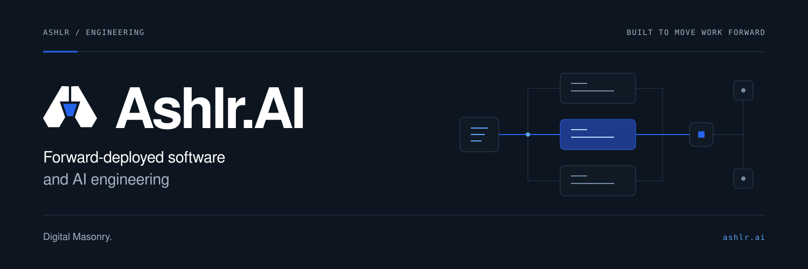
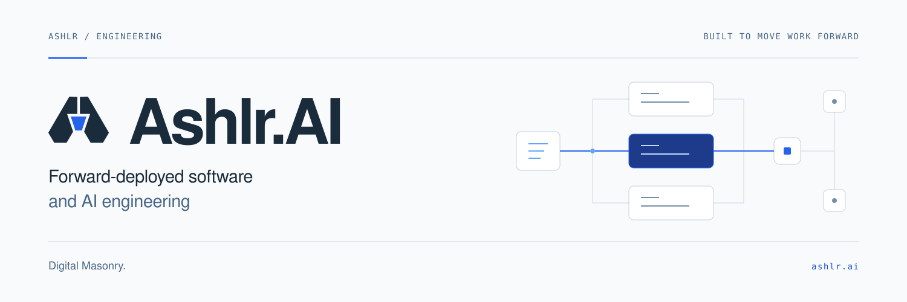
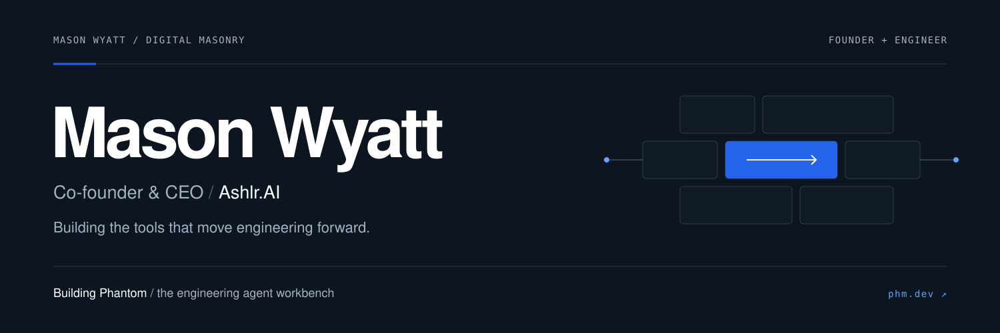
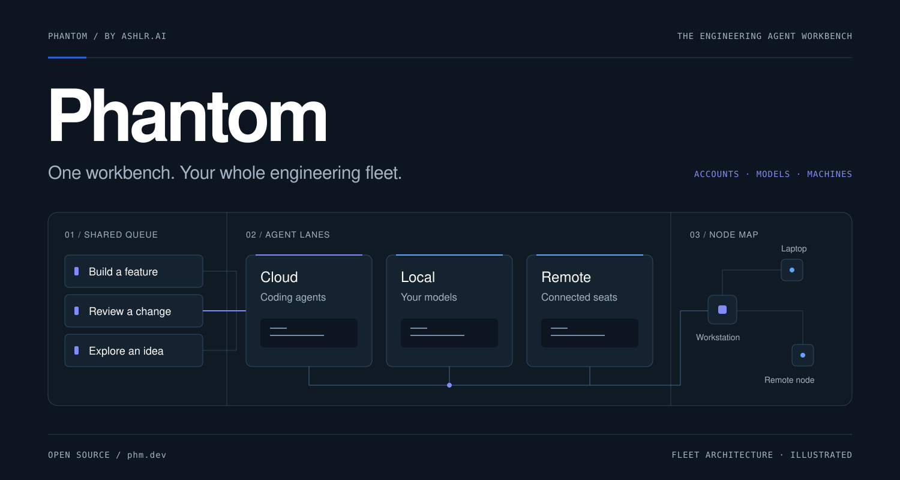
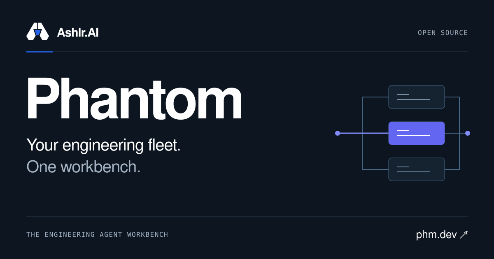

# Ashlr.AI media kit

Five self-contained SVGs, one shared visual language: navy foundations, electric-blue routes, generous space, and the canonical keystone. Phantom adds its own indigo accent. The fleet illustrations describe the architecture; they contain no live metrics or version numbers.

This directory is the reviewable source kit. Applying it to profiles, the repository README, or website metadata is a separate step. The raw URLs below become available after these files land on `master`.

## Manifest and previews

[manifest.json](manifest.json) records dimensions, themes, destinations, alt text, and the OG export's source digest. All paths are relative to this directory.

| Asset | Canvas | Intended placement |
| --- | --- | --- |
| [Organization / dark](org-banner.svg) | 1500 × 500 | Top of `ashlrai/.github/profile/README.md` |
| [Organization / light](org-banner-light.svg) | 1500 × 500 | Light-theme source for the same banner |
| [Personal](personal-banner.svg) | 1500 × 500 | Top of `masonwyatt23/masonwyatt23/README.md` |
| [Phantom hero](phantom-hero-v2.svg) | 1500 × 800 | `ashlrai/phantom/README.md` hero |
| [OG master](og-card.svg) / [PNG export](og-card.png) | 1200 × 630 | phm.dev link previews; GitHub social-preview upload |







## README embeds

Organization: the explicit light source keeps the mark and copy legible without depending on styles inside an SVG. Dark is the fallback.

```html
<a href="https://ashlr.ai">
  <picture>
    <source media="(prefers-color-scheme: light)" srcset="https://raw.githubusercontent.com/ashlrai/phantom/master/docs/brand/org-banner-light.svg">
    
  </picture>
</a>
```

Personal:

```html
<a href="https://phm.dev">
  
</a>
```

Phantom README:

```html
<a href="https://phm.dev">
  
</a>
```

Compact card for another README:

```markdown
[](https://phm.dev)
```

Keep the natural aspect ratio. GitHub constrains the image to its content column; avoid fixed heights or cropping. On other sites use `max-width: 100%; height: auto`. Keep adjacent profile text for small screens, where illustration labels become secondary. Personal, hero, and social assets intentionally retain their navy canvas in either theme. For an immutable embed, replace `master` with the reviewed commit SHA.

## Social export

Use the supplied **PNG**, rather than the SVG master, for Open Graph, Twitter/X cards, and GitHub's social-preview upload. The PNG has an opaque background and fixed typography. Uploading it or changing metadata is outside this kit's apply step.

```html
<meta property="og:image" content="https://raw.githubusercontent.com/ashlrai/phantom/master/docs/brand/og-card.png">
<meta property="og:image:type" content="image/png">
<meta property="og:image:width" content="1200">
<meta property="og:image:height" content="630">
<meta property="og:image:alt" content="Phantom by Ashlr.AI — Your engineering fleet. One workbench.">
<meta name="twitter:card" content="summary_large_image">
<meta name="twitter:image" content="https://raw.githubusercontent.com/ashlrai/phantom/master/docs/brand/og-card.png">
<meta name="twitter:image:alt" content="Phantom by Ashlr.AI — Your engineering fleet. One workbench.">
```

## Brand sources and editing

The palette and Space Grotesk direction come from `ashlar-landing` at revision `fdbfb36ce411814b8a2977b5eb6048692c0f03f1`: `tailwind.config.ts`, `lib/fonts.ts`, and `docs/ASHLAR_LOGO.md`. The keystone paths are copied from its `components/brand/keystone.ts`, the canonical vector trace of the [organization mark](https://github.com/ashlrai/.github/blob/main/profile/assets/logos/ashlar-mark.png). They retain the flat blue core, split apex, proportions, and clear space. White legs on dark and navy legs on light follow the source's reversed and full-color treatments.

The kit uses a system sans stack (`-apple-system`, `BlinkMacSystemFont`, `Segoe UI`, Helvetica, Arial) and a system monospace stack. No font fetches, bundled font files, raster images inside SVG, scripts, filters, or animation. System fonts vary slightly across platforms; the spacing allows for that. The [existing personal banner](https://github.com/masonwyatt23/masonwyatt23/blob/main/assets/banner.svg) informs the masonry motif and role. [Phantom branding](../PHANTOM-BRAND.md) supplies the product name and positioning.

Edit the SVG text and geometry directly. Keep organization variants geometrically identical, changing only palette values. Preserve the keystone's uniform scale and original colors; do not add effects. SVGs are deliberately small and readable, with a 10 KiB budget each. Their embedded `title` and `desc` support standalone viewing; retain meaningful `alt` text when embedding.

## Verification and export

From the repository root, using the existing development dependencies:

```sh
task_test_home=$(mktemp -d)
env HOME="$task_test_home" npm run test:ci -- test/brand-media.test.ts
```

The suite parses every SVG as XML, checks dimensions, accessible labels, unique IDs, local reference resolution, dependency-free embedding, manifest completeness, theme geometry, and PNG dimensions/source freshness. It also validates this guide's local links. XML validation alone cannot prove visual layout: open all five files in a browser at native size and at a README-sized width after edits.

The PNG was rendered with librsvg 2.62.0 on macOS. If `rsvg-convert` is already available, regenerate it with `rsvg-convert docs/brand/og-card.svg -o docs/brand/og-card.png`. Otherwise export at 1200 × 630 from a browser or SVG editor. After inspecting the new raster, update `rasterSourceSha256` in the manifest to the SHA-256 of `og-card.svg` (`shasum -a 256 docs/brand/og-card.svg`). This acknowledges a reviewed export; the digest is not a pixel-equivalence test. No new package dependency is needed.
