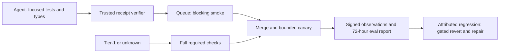

# Agent-native CI: verify in the loop, observe every merge

Status: advisory proposal, RQ-CI-RIGHTSIZING-1. Security review is required before applying the [workflow patch](ci-rightsizing.patch). This change activates no workflow, ruleset, publisher, observer or revert authority. Baseline: `96a5a9be22abc2b23f311af2017f3c246b287156`.

## Decision and existing evidence

Move focused verification and typechecking into the agent's pre-push loop. Keep a blocking smoke check on each candidate, full checks on Tier-1 changes, hourly backend verification, daily platform coverage, and a causal post-merge canary. Retain the existing required `Merge Gate` and merge queue; do not remove required checks or use admin bypass.

The checkout already implements much of the scheduling model, but not the risk distinction:

| Existing surface | Current behavior | Proposed change |
| --- | --- | --- |
| `.github/workflows/ci.yml` | PRs/merge groups defer full CI for every risk tier; `quick` failures are advisory in Merge Gate | Blocking smoke; full checks for protected changes |
| Scheduled CI | Full suite every six hours; Mac exhaustive coverage rotates over seven days | Hourly existing backend matrix; daily complete Mac/Windows lanes |
| `scripts/verify-changed.mjs` | Changed-file lint, backend types, conditional web types, drift checks, cached tree receipt | Require separate focused tests; bind an authenticated receipt to all required checks |
| `scripts/bridge/publish.sh` | Completion hook for disk bookkeeping | Do not mistake this for the pinned host publisher's verification gate |
| `src/core/fleet/eval-report.ts` | Revert/regression/follow-up outcomes, 72-hour maturity, unknown coverage and Wilson intervals | Join verification policy, risk and canary evidence per merge |
| `src/core/fleet/post-merge-watch.ts` | Per-landing watch, parent comparison, gated fleet revert and repair | Reuse its authority and escalation path; bound canary work |

The live pinned `publish.sh` and installed dispatcher were not inspected or modified. Repository source and a successful local command do not prove deployed pre-push enforcement. Full-suite results on a scheduled tip also do not prove every intervening merge was tested separately.

## Verification contract



Before push, the agent runs `node scripts/verify-changed.mjs`, `npm run check:docs`, and affected suites through `npm run test:ci -- <files>` with a temporary HOME. Web changes also require web typechecking and affected web tests. Select text-reading contracts explicitly; the import graph alone cannot find them. A zero-test selection, missing checker, timeout, dirty tree after verification or failed check is not a verified result. Cached verification excludes focused tests today; it is not a complete receipt.

The proposed `ci.verification.v1` receipt records repository ID, base SHA, candidate SHA/tree, lockfile digest, CODEOWNERS/policy digest, checker versions, selected suites plus selection reason, commands' exit codes/test counts, start/end times and trusted executor identity. Store metadata and output digests, never raw output or credentials. Sign through existing custody; do not create CI signing secrets. Candidate-authored JSON or a PR label cannot attest its own success.

The host verifier must derive commands from reviewed policy and verify all required fields before emitting its existing authenticated check. Reuse `host-merge.ts` / `verify-check-run.ts`; do not introduce another check writer. Rebase, candidate edits, changed policy/lockfile, stale receipts (proposed limit: 24 hours), failed signature or missing evidence require re-verification or full CI. Queue synthesis must validate the union of constituent diffs against the queue base and rerun focused integration checks when constituent trees cannot prove the synthesized tree. Never reuse a green check solely by branch name.

## Risk selection and required checks

Read the selector and `.github/CODEOWNERS` from the authenticated event base SHA, not candidate bytes. GitHub likewise uses base-branch CODEOWNERS for PR review. [GitHub CODEOWNERS documentation](https://docs.github.com/en/repositories/managing-your-repositorys-settings-and-features/customizing-your-repository/about-code-owners).

| Candidate | Required path after review |
| --- | --- |
| Unowned regular Markdown or ordinary `test/**/*.test.ts` only | Local verification plus hosted smoke |
| Ordinary source with an authenticated complete receipt | Target model: hosted smoke plus post-merge canary; deferred until receipt integration |
| Any CODEOWNERS-protected path, including protected tests/docs, manifests, CI and release configuration | Smoke plus full backend/platform checks; existing Security pins and review remain |
| Source without trusted receipt, mixed protected/unprotected changes, executable/symlink/submodule, empty diff | Full checks |
| Missing base, checkout mismatch, unreadable/malformed ownership map or unknown selector syntax | Classification fails; Merge Gate fails closed |

The standalone [selector](../../.github/scripts/ci-risk-selection.mjs) implements the first, conservative rollout: unowned docs/tests may select smoke; ordinary source remains full. It recognizes the generated ownership grammar, conservatively unions owned rules and matches case-insensitively. Unsupported grammar fails rather than silently dropping a rule. Git diffs use NUL delimiters and disable rename detection so moving a protected file cannot hide its deletion. PR changes use the merge base for the diff and current event base for ownership; merge-group changes cover the whole synthetic candidate.

Smoke means changed-file lint, both existing secret checks, generated-file checks, CODEOWNERS/import-closure drift and the existing conditional MCP output contract. These remain blocking on docs-only candidates too. New Tier-1 imports must fail drift before any lighter path can qualify. The patch retains the `Quick typecheck` job name for consumers, but omits hosted typecheck only for smoke-qualified docs/tests. Typecheck remains local and runs in full lanes. This is not permission to weaken or delete tests.

Keep `pull_request`, `merge_group` and direct `master` push triggers. Required queue checks need `merge_group`; schedules can be delayed or dropped and are not a canary deadline guarantee. [GitHub workflow events](https://docs.github.com/en/actions/reference/workflows-and-actions/events-that-trigger-workflows).

## Concrete workflow proposal

The [patch](ci-rightsizing.patch) changes only `ci.yml`. It introduces no permissions, secret references, action dependencies, privileged triggers or credential persistence. Both secret jobs and release-build are byte-for-byte unchanged. The stable Merge Gate requires `quick` on fast events and every full platform job on full-risk candidates; missing, skipped, cancelled and failed required results fail it. Existing reusable push/tag platform deferrals remain explicit.

The hourly schedule at `17 * * * *` runs the existing `ci` matrix (including its Windows portability leg). The daily `47 3 * * *` run adds all Mac lanes and Windows service authority, with Mac rotation disabled for schedules. Manual slice selection remains diagnostic; only an unsliced run proves complete platform coverage. The half-hour release-preparation schedule is preserved. Direct master pushes retain quick verification and the release consumers' exact-commit gate.

Review without activation:

```sh
git apply --check docs/strategy/ci-rightsizing.patch
test_home=$(mktemp -d)
env HOME="$test_home" node --test .github/tests/ci-risk-selection.test.mjs
```

The tests apply the patch in a temporary directory, parse YAML, execute its Merge Gate script against success/failure matrices, and classify real Git diffs. They do not certify hosted timing, deployed rulesets, custody receipts or platform runners. Land the dormant selector first through the existing checks; a subsequent reviewed workflow change can load it from base. Activation must update historical workflow-policy assertions in `test/m30.ci.test.ts` and schedule/release consumers to the approved contract, without dropping security coverage. Do not apply the patch mechanically and claim current policy tests will pass unchanged.

## Post-merge canary and regression detector

Every merge gets a metadata receipt linking repo, PR, merge SHA, first parent, originating job/lane, risk and verification policy version. A host-owned, bounded queue schedules a focused canary within five minutes (target, not measured), deduplicated by repo + merge SHA + suite digest. Concurrency is capped by existing verification leases. Canary backlog age and missing coverage are failures of observation, never evidence of stability. Do not move full per-merge CI into an unbounded background queue.

Extend the eval projection with `verificationMode`, `riskTier`, `policyDigest`, `canaryState`, `canaryObservedAt`, `coverageState` and evidence IDs. The current `byTier` means executor tier, not change risk: add `byRisk` and `byVerificationMode` rather than relabeling it. Preserve v1 consumers via a versioned/additive projection. Join on authenticated repo + merge SHA; deduplicate observation event IDs and retain both original and superseding evidence. These fields and ingestion are proposed here, not implemented by the selector.

Feed existing signed `post-merge-observations.ts` producers with deterministic revert references and bisect-first-bad evidence; overlapping fixes stay heuristic. Preserve its closed schema and `post-merge-stability.ts` signatures. Do not append invented unsigned row fields or let the report write execution authority. A mature merge needs an intact covering observation channel for 72 hours; pending, missing, degraded and truncated evidence remain explicit. Adverse evidence supersedes a previously stable projection. A sampled passing scheduled tip must not synthesize a stable witness for every ancestor.

On a failed canary, repeat the same check once on the exact merge SHA, compare its first parent with the same suite/toolchain, then bisect a bounded last-green-to-first-red interval if attribution is ambiguous. Infrastructure failures and failures inherited from the parent do not identify a culprit. Keep suspect intervals and failed fingerprints; never count one scheduled red as a regression for every merge in that interval.

For a reproducible, newly introduced failure with one authenticated fleet culprit, use the existing post-merge watch's gated revert/repair path. Validate the revert against current main, verify its resulting tree and land through the existing queue and checks, without force-push or admin override. Preserve Security pins, KILL, holds, conflict escalation and the rule that a failing revert is not recursively reverted. Heuristic follow-ups and rising aggregate rates produce investigation/repair work, not automatic reverts. Existing watch behavior can conservatively revert when parent evidence is unavailable; changing that policy requires a separate reviewed authority change. This proposal adds no second rollback controller or GitHub write permission.

## Metrics and adoption criteria

Measure a 14-day baseline and compare matched cohorts by repo, change risk, diff size, executor tier and policy version. Publish hourly operational counters and daily matured cohorts ending at least 72 hours before report time. Keep every numerator, denominator and missing-data count visible.

| Metric | Definition |
| --- | --- |
| Merge velocity and delay | Unique merged SHAs/day; p50/p95 enqueue-to-merge and queue-wait seconds; report measured population |
| Verification cost | Agent + hosted + canary runner-minutes per merge, including retries/cancellations; billable spend separately |
| Defect rate | Unique matured merges with any adverse evidence / covered matured merges; overlapping outcomes count once |
| Revert/regression/follow-up rates | Each outcome's unique merges / same denominator; expose deterministic versus heuristic evidence separately |
| Observation coverage | Covered matured / all matured merges, plus pending and unobserved counts; no denominator means null |
| Detection/recovery | p50/p95 merge-to-first-attributed-red and red-to-verified-repair; record censored/unresolved cases |
| Selector/receipt health | Full/smoke shares, disagreement with full CI, missing/stale/invalid receipts, canary backlog p95 |

The existing eval report uses resolved merges (stable + adverse), which can include early adverse outcomes. Keep that view, but use equal-age matured cohorts for policy comparisons to avoid counting early failures against unresolved recent successes. Report per-outcome sets in the new projection: v1's precedence-based durability label is not an independent count of every outcome. Include Wilson 95% intervals and show small samples as inconclusive; lane rankings alone cannot establish causation.

Capacity model: for M merges/day, high-risk share H, smoke minutes S, full-suite minutes F and canary minutes C, hosted demand is approximately `M*S + M*H*F + M*C + scheduled minutes`, plus retries. Include local verification in total cost. For illustration only, 3,000 merges/day, H=5%, S=0.5, F=20, C=0.25 gives 5,250 runner-minutes/day before schedules/retries, versus 60,000 for full CI per merge. Measure H: the generated protection map is broad, so 5% is not a forecast. Queue wall time also depends on admission/batching and available runners.

1. Ship this dormant proposal/selector and collect risk/cost/coverage measurements. Security reviews the workflow diff and current required-check inventory; no ruleset removal, pin changes or spending activation is implied.
2. Pilot docs/tests smoke after review. Proposed targets: smoke p95 below 90 seconds, canary start p95 below five minutes and at least 99% matured coverage. Establish at least 1,000 covered mature merges over seven days before widening. Pause expansion for any attributable severe regression, a coverage breach, or a defect-rate increase above 0.5 percentage points relative to the matched baseline; treat overlapping confidence intervals as inconclusive.
3. Add authenticated receipt integration, canary ingestion and the versioned eval projection, then pilot ordinary-source smoke. Acceptance includes forged/stale receipts, mixed queue groups, unknown base, observation outages, inherited red, flakes, duplicate events, conflicting reverts and red-revert drills. Keep Tier-1 full checks throughout. Roll back the routing policy to full checks through a reviewed forward change if targets fail; main-guardian repairs main independently.

Thousands of merges/day remains a target. This proposal supplies an executable selector and a tested workflow draft, not measured throughput or evidence that receipts, canaries and automated rollback are commissioned.
