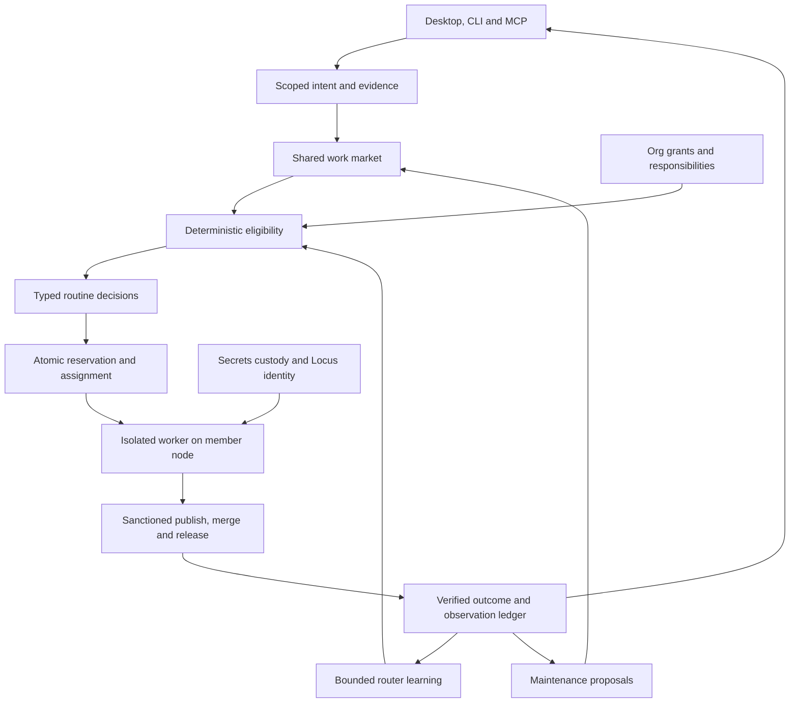

# Phantom end-state architecture

Status: proposed architecture, docs and spec only. Job: RQ-RETHINK-ENDSTATE-1.
Evidence baseline: 2026-11-13, source revision
`00b72c2ea60de124051bb687a80f94663378d3b5`.

Phantom is the operating system for an engineering organization whose workers
are agents. Humans set outcomes, grant bounded access and decide the exceptions
only they can decide. The system converts evidence into useful work, assigns
available capability, ships through the sanctioned repository workflow, observes
the result and removes machinery that no longer earns its cost.

This is the tie-off point for future architecture work. Every proposed build
must name a decision below, its user outcome, the existing component it extends,
the component it retires and its acceptance evidence. A new control plane,
queue, credential store or approval screen needs a demonstrated failure of the
existing seam. Features without that connection return to proposal status.
This is an architecture admission rule, not another runtime or merge approval.

## Authority and evidence

[AGENTS.md](../../AGENTS.md) and the [constitution](../../CONSTITUTION.md)
remain the authority. This spec grants no access, spending, send, installation,
merge or release permission. Keep Security GATES v3, owner holds, private-data
boundaries, fork-only publication through `publish.sh`, required merge-queue
checks and sanctioned releases. Never use an admin bypass or force-push to the
default branch. Local inference stays on loopback. Fix shipped code forward.

Cut repeated human approvals for engineering already within a standing grant.
Keep human intervention for passwords, 2FA, device approval, payments and other
retained limits. Models, claims, team roles and channel labels cannot create
those grants. Existing runtime refusals remain real until a separately scoped,
reviewed implementation replaces them. An architecture document cannot enable
a withheld daemon or bypass a Security pin.

The supplied fleet snapshot names RQ-SHARED-QUEUE-1 as live. Decision D1 specifies
its integration boundary and does not assign a competing implementation. The
requested `queue/prompts/` spec is absent in this checkout; its exact contract
must be reconciled with that owner before code is written. The private rethink
`PROGRAM.md` was unreadable. No private program text is reproduced here.
The local constitution has Articles 1 and 9, with no Article 2. The entries at
the end preserve requested traceability without inventing constitutional text.

Current-state statements below come from local contracts and implementation,
not a claim of installed-app or production acceptance. Missing telemetry is
unknown. An installed binary, configured adapter, passing fixture or open PR
proves only that stage. [Agent operations](../AGENT-OPERATIONS.md) explains
these distinctions; the [AGENTS audit](../AGENTS-MD-AUDIT.md) is a historical
instruction-coverage snapshot, not runtime certification.

## Optimize outcomes, not occupied seats

The primary measure is accepted owner outcomes per elapsed day within the
existing resource grant. Engineering outcomes include deployed, verified fixes;
research and operations use their own explicit artifact or effect receipts.
PR count is a diagnostic. Splitting one fix into ten PRs earns no extra outcome.

Track end-to-end time, observed durability, quota consumed, attributable cash
cost, human interruptions and maintained code/doc/machinery size. Report sample
counts and coverage beside every rate. Count failed attempts, duplicates,
recuts and repair work as costs. Capacity utilization alone never generates work.
A quiet, healthy organization is a valid state.

## One kernel, seven responsibilities



The kernel owns work identity, transitions, assignment and evidence joins.
Provider adapters own execution mechanics. Phantom Secrets owns credential
custody; Locus binds account identity and scope. The desktop owns presentation.
The org plane owns responsibility and contributed capacity. None duplicates
the others' policy or durable truth.

| Record | Durable owner and invariant |
| --- | --- |
| Work item | Evolve the existing queue store; one outcome ID with dependency and attempt lineage. Markdown/TSV become compatibility projections. |
| Coordination lease | Existing [claim table](../../src/core/agents/claim-store.ts); overlap rules apply across bus, team and board callers. A lease is not authority. |
| Dispatch assignment | Market reservation tied to job revision, attempt, lane, member, node, model, effort, policy revision, expiry and fencing generation. Secrets never enter this record. |
| Decision receipt | Existing [decision layer](../../src/core/decide/index.ts); schema, input hash, candidate-set revision, chosen label, fallback reason and qualified usage. |
| Outcome | Verified artifact/PR/merge/release identity plus observation coverage; job completion and deployed acceptance are distinct. |
| Conversation | Existing owner thread for private owner text; existing bus for permitted agent/team envelopes. Shared IDs connect projections without copying private bodies. |
| Access | Scoped grant plus local custody reference; membership and capacity contribution never transfer provider login. |
| Machinery | Existing [manifest](../../fleet/manifest.json); source digest, custody class and adoption receipt remain distinguishable. |

Use durable local transactions and bounded journals first. Do not introduce a
broker cluster to coordinate one machine. Cross-node operation uses an explicit
authoritative coordinator and fencing; partitions cannot create a second writer.
The existing [node network](../AGENT-NETWORK.md) is the migration seam. Bus TTL
retention cannot serve as permanent outcome history. Every projection carries
source health, revision and observation time so stale state stays visible.

## D1. Shared work market

**Current gap.** [queue.v1](../QUEUE.md) is dispatch-neutral but requires a
`pool`; its local claims record owner/time and have no automatic reclaim.
`DONE` is operator-reported, not merge evidence. The Markdown queue, ready.tsv
and scheduler views coexist. [Bus v2](../AGENT-BUS.md#v2) already unifies resource
claims, but its proposed work-feed projection is not implemented. A queue read
is not a dispatch lease. Hard-coded lane ownership strands otherwise feasible work.

**Target.** A work item describes capability requirements, repo/path scope,
owner/client privacy scope, priority, deadline if real, acceptance evidence,
dependencies and resource ceiling. Stage (`plan`, `implement`, `verify`) and
tier (`frontier`, `work`, `mid`, `fast`) express judgment needs, not vendor names.
Task prose stays untrusted model input; queue text never becomes shell or
execution authority. Trusted adapters construct validated executable arguments.
A lane offer describes supported stages, tools, context capacity, environment,
local identity binding, fresh availability and contributed quota. A preferred
lane is a hint; a mandatory lane is a typed constraint with a reason.

Select by deterministic scope, capability, authority and resource admission,
then rank feasible offers. Routine classification can advise ranking. Commit
an assignment and capacity reservation with compare-and-swap on the job revision
and the shared coordination lease. Where stores cannot transact together, use
a write-ahead reservation intent plus idempotent reconciliation before launch.
Never launch between a partial claim and partial reservation. A leased job has
one active attempt and an immutable launch lane. Reject stale fencing generations
on heartbeat, completion and publication handoff.

Durable transitions distinguish ready, reserved, running, artifact-ready,
PR-open, merged, released and accepted, plus blocked/failed/cancelled outcomes.
These are proposed market semantics, not new valid queue.v1 status strings.
Dependencies specify the required evidence milestone; a merge dependency cannot
be satisfied by local DONE. Lease expiry fences the prior attempt and reconciles
its process and external effects before retry. An uncertain publish or send is
reconciled by external identity, never blindly replayed.

**Migration.** RQ-SHARED-QUEUE-1 owns the work contract. Extend its proposal at
the existing [schema/store seam](../../src/core/queue/schema.ts), with an explicit
version migration. Import legacy pools as compatibility constraints first;
relax only rows whose capability and privacy requirements can be reconstructed.
Unparseable, unspecified and ownerless imported claims stay visible and unresolved.
Run a shadow assignment projection, compare readiness and eligibility, then
transfer one bounded cohort under a cutover epoch. Exactly one scheduler owns
that cohort. dispatchd remains the fallback for cohorts it still owns. Drain
pre-cutover attempts before retiring its queue writer. Preserve IDs, tombstones,
retry lineage and [route hysteresis](../ROUTE-HYSTERESIS.md).

**Cut.** Per-lane queue authorship, lane-specific copies of the same job,
independent scheduler claim tables, prompt prose as dependency truth and filler
restocking whose only acceptance is a busy seat. Retire old queue writers after
consumer receipts prove migration; retain read compatibility while used.

**Exit evidence.** Offline replay plus a bounded live cohort demonstrate no
duplicate launches or lost work across crash, lease expiry, coordinator failover
and cutover. The same capable job moves between eligible idle lanes without an
edited prompt; an out-of-scope member never sees its private payload.

## D2. Typed routine decision layer

**Current gap.** [Jev integration](../JEV-INTEGRATION.md) already provides
`decide`/`decideEach`, schema validation, thresholds, caching, budgets, disable
controls and deterministic fallback. Some callers retain separate task-class
vocabularies and parsing ladders. Confidence measures distribution sharpness,
not calibrated correctness. Another classifier service would multiply drift.

**Target.** One registry of bounded decisions: intent, task class, engine error,
retry category, routine triage and feasible-lane ranking. Each kind owns its
versioned schema, closed labels, input minimization, task-specific calibration,
deadline, cost ceiling and deterministic fallback. Free deterministic rules run
first when they settle the question. A configured fast model handles ambiguous
routine labels. Frontier models do architecture, implementation and substantive
verification; a typed parser does not replace an engineering judge.

Advice may select only candidates supplied by admission. Recheck admission and
Stop after asynchronous calls and before effects. Malformed, unavailable,
unkeyed, late or insufficient-confidence results fall back. Ambiguous work can
escalate its engineering stage within the grant. Safety and cryptographic
state machines stay deterministic; model advice near them can only escalate.
Cache keys include schema and policy revisions and the admitted candidate set.
Receipts omit classified text, account identifiers and secrets.

**Migration.** Consolidate duplicate labels and parsers through existing
`src/core/decide/` call sites, one kind at a time. Capture baseline confusion and
fallback rates on scrubbed fixtures. Shadow advice before enabling it for that
kind. Keep compatibility label mappings only for persisted historical records;
new writes use the canonical vocabulary. Paid calls remain unavailable without
existing spend authority; a daily-call preference is not permission to spend.

**Cut.** Frontier prompts for routine routing, independent keyword taxonomies,
JSON-repair/reprompt chains where a validated contract can replace them,
provider-specific decision clients and duplicated ledgers. Keep one deterministic
fallback per kind; it is the availability path, not dead code.

**Exit evidence.** Each migrated kind has replayable classification quality,
latency, fallback and cost coverage. Model outage preserves dispatch availability;
a fabricated eligible label, cached stale offer or high-confidence answer never
widens authority.

## D3. Credential plane

**Current gap.** The [toolchain](../AGENT-TOOLCHAIN.md) separates vault references
from Locus identity. [Provider integration](../../src/core/integrations/secrets.ts)
supports child `phantom exec` while legacy in-process clients use their existing
environment. Parent-process vault extraction is unsupported. The Jev contract
still has a private-file fallback. Channel setup spans several configs; naming a
handle does not prove that an authenticated transport works. Universal refs,
password-manager migration and agent-operated MFA/SSO are targets, not shipped facts.

**Target.** Phantom Secrets is the universal credential substrate. Jobs and
agents see an opaque reference plus capabilities and readiness metadata. A
trusted local executor binds the exact principal, destination, operation,
expiry and grant before injecting credentials into the permitted child or
performing a brokered request. Secret values, session cookies, password exports
and OTP material never enter model context, screenshots, argv, bus bodies or
logs. Locus verifies the account binding; the vault reference alone is insufficient.
A generic exec wrapper is not a sealed-job credential bridge.

One-grant onboarding presents a concrete bundle of repositories, accounts,
operations, contributed capacity and transports. It records a revocable scope
and verifies each connection with value-free probes. It does not mean one
unlimited grant or silently approve a newly discovered integration. Increasing
scope needs its actual authorization. Revocation cancels future resolution and
fences queued work; in-flight effects have explicit reconciliation receipts.

Agents operate already authorized SSO session renewal and MFA orchestration
through the credential broker. They can detect a challenge, preserve a resumable
flow and continue after custody proves completion. Password entry, 2FA approval,
device approval and payment stay with Mason under current authority. Unattended
challenge satisfaction requires separately authorized, reviewed delegated custody;
this spec neither assumes it exists nor transfers MFA seeds to an agent.

Password-manager migration uses a value-blind manifest of item categories,
references and supported consumers. Import runs entirely inside trusted custody,
with resumable per-item receipts and a non-secret success/failure count. Verify
each migrated consumer before deprecating its legacy route. Never delete the
source vault, export file or credential as a side effect of this architecture.

**Migration.** Inventory consumers by transport and principal without reading
values. Move ordinary children to existing exec custody. Give in-process APIs a
reviewed broker transport before retiring environment/private-file fallbacks.
Converge connection config around reference IDs, then implement the onboarding
bundle and resumable SSO flow. Keep unsupported providers explicitly unsupported.
Credential, auth and loopback changes take their applicable Security review;
no direct edits to host auth, pins or sandbox wrappers are part of this work.

**Cut.** Copied auth directories, inline credential fields, reveal helpers as a
proposed integration strategy, per-adapter secret stores and repeated manual
configuration for the same verified account. Remove a compatibility credential
path only after all supported consumers pass through custody.

**Exit evidence.** A fixture credential completes child and brokered requests
without appearing in any captured output; revoked/wrong-account grants refuse.
A new owner connects the declared bundle once, receives a precise needs-you
challenge when required and resumes without re-entering completed setup.

## D4. Unified Phantom surface

**Current gap.** [Owner thread](../OWNER-THREAD.md) already orders private owner
messages across desktop and configured channels. [Channels](../CHANNELS.md)
also exposes inbox, bus and outbound sources. Setup, pairing, transport readiness,
app control and pending approvals are spread across interfaces. A local append
or accepted draft does not prove remote receipt. Bus v2 labels are not identity.

**Target.** The desktop is the primary control room for outcomes, work, people,
connections and exceptions. Fleet state, owner/Dot/team conversations, app
control and needs-you are views over kernel contracts. CLI and MCP expose the
same operations and revisions so headless work remains fully supported.

Keep separate audience boundaries in one interface: private owner thread,
authenticated agent peers such as Dot, and verified team conversations. A shared
inbox can show safe summaries and deep links, not copy owner text into team bus
messages. Preserve the six-field bus envelope and typed v2 bodies. Transport
adapters map identities and threads; they do not reinterpret text as authority.
Dot uses the existing peer/bus contract, not a special second inbox protocol.

Every effect has a stable operation ID and distinct accepted, queued, attempted,
confirmed and unknown states. Unknown send outcomes require reconciliation.
Outside-team sends remain drafts pending the applicable explicit authorization;
approving a draft is not automatically send authority. Needs-you contains only
real hard-limit decisions or unresolved failures, deduped by underlying operation.
Its primary action shows scope and consequence. Successful automation stays out
of the approval queue. App control uses existing allowlists and TCC boundaries;
unsaved work cannot disappear behind a generic Quit action.

**Migration.** Build shared read models from owner-thread, claim, queue, app and
approval services. Connect existing desktop panes to these models before
replacing navigation. Consolidate channel setup into D3's connection bundle,
retaining pairing and transport probes. Migrate legacy file readers with cursor
checkpoints and receipt IDs; do not double-publish both old and new inbox paths.
Replace obsolete manuals with short redirects only after their readers move.

**Cut.** Independent status truths per pane, one inbox per provider, duplicate
needs-you items, plan-log scraping once typed reply producers are adopted and
approval prompts for already granted routine work. Keep private stores and
audience checks even when their views share a screen.

**Exit evidence.** A single synthetic request can be followed from inbound
receipt to work, artifact and same-channel reply in desktop/CLI/MCP. Replay
creates one item, uncertain delivery is visible, KILL halts effects, and private
owner content never appears in a team or Dot projection.

## D5. Self-tuning router

**Current gap.** [Fleet eval-report](../../src/core/fleet/eval-report.ts) scores
post-merge durability by lane/tier/repo and is read-only. It requires a covered
72-hour observation window for stable credit and uses Wilson lower bounds.
[Outcome learning](../../src/core/routing/outcome-learning.ts) offers another
routing seam. These do not establish complete attempt costs or an automatically
commissioned live feedback controller. Multiple advisors must not become writers.

**Target.** One controller consumes verified outcome cohorts and writes versioned
ranking policy for future unlaunched work. Join outcome ID, all attempt IDs,
assignment revision, model/effort, PR identity and merge SHA. Include failed and
empty attempts, recuts, classification overhead and attributable repair work.
Deduplicate PRs across jobs; ambiguous attribution stays unknown.

Fix cohort membership by originating outcome and intake window before scoring.
Keep later retries and repairs attached; report observation cutoff and pending
outcomes so slow or failed work cannot disappear from the cost numerator.
For cohort C, publish these metrics with their coverage:

```text
cash per merged PR(C) = attributable cash for all C attempts / unique merged PRs(C)
cash per durable PR(C) = attributable cash for all C attempts / observed stable PRs(C)
quota per accepted outcome(C) = attributable quota / accepted outcome IDs(C)
```

Zero denominators or missing required cost evidence yield unknown, not zero.
Fixed subscriptions get a separately labeled allocation basis; quota, ACUs,
tokens and cash stay separate units. Unused subscription capacity is not free
cash, and an estimated tariff is not an invoice. Count maintenance burden and
human interruption alongside cost. Compare like repo/task-class/stage cohorts;
keep sparse combinations on conservative priors. Do not claim lane causality
from an unbalanced observational sample.

Rank feasible candidates by expected accepted outcome value, elapsed time and
resource cost, subject to a durability floor. This is constrained optimization,
not cheapest-model-first or maximum PR count. Adjust lane weights, bounded task
scope and supported effort settings; never grants, spend ceilings, safety rules,
required checks or credentials. A scope split retains parent acceptance and
cannot manufacture additional reward. Engineering judgment stages retain the
frontier policy required by [stage delegation](../QUEUE.md#stage-delegation-bottleneck-only).

**Migration.** First reconcile eval-report and outcome-learning into one input
projection and one policy writer. Collect immutable attempt/cost/observation
joins. Replay competing policies offline, then run the controller in shadow.
Initial proposed activation thresholds are at least 30 resolved comparable
outcomes per changed cohort, 95% attribution/cost coverage and no degradation
against the frozen baseline durability bound. These are design defaults, not
observed fleet scores; validate their usefulness before activation. Reserve at
most 5% of eligible capacity for bounded exploration within existing grants.

Evaluate hourly. Change at most one setting per cohort per day, by at most 10%
for weights or one supported scope/effort step. Start with a 5% assignment cohort;
expand after its covered observation window. Recheck admission at launch and
retain 60-minute route residency, immutable launch lanes and the two-moves per
six-hours cap. On stale/corrupt evidence, freeze learning and use the last
validated deterministic policy with fresh admission. Quality deterioration stops
expansion and creates a bounded fix-forward job; it never rewrites history or
reverts shipped code.

**Cut.** Hard-coded perpetual lane rankings, token-only winner tables, competing
policy writers, cost dashboards without coverage and reflexive retry loops that
hide their cost. Retain deterministic fallback and post-merge observers.

**Exit evidence.** Frozen replay shows why each proposed change improves the
stated objective; delayed failures, missing cost, stale telemetry and reward
splitting cannot produce a promotion. A covered live cohort proves bounded
policy changes and absence of route thrash without new spending.

## D6. Agent organization plane

**Current gap.** [phm org](../AGENT-NETWORK.md#team-org) records members,
machines, responsibilities and opted-in lane shares; planning is advisory and
join records are local. [phm team](../TEAM.md) has local membership/context and
access requests. Matching team IDs on two machines do not synchronize state.
Activity labels, provider identity, membership and execution authority differ.

**Target.** Org describes human ownership, projects, client boundaries,
responsibilities and contributed capacity. Team describes collaboration and
access within that org. Agent profiles describe versioned capability, not a
provider account. Persistent responsibilities survive replaceable sessions:
one accountable role owns the outcome, next action and escalation destination.

Admission intersects owner scope, team membership, repository grant, contributed
share, local provider binding and current capacity. Agents may redistribute
responsibilities inside that intersection; they cannot invite members, raise
contributions, elevate roles or borrow another person's login by relabeling a
job. Human-terminal membership changes and current access-request approvals
remain in effect. Machine loss or membership removal fences future work and
reconciles outstanding handoffs without copying auth to a replacement host.

**Migration.** Link existing org IDs, team IDs and agent profiles with explicit
provenance. Project responsibility and resource offers into D1; keep D3 custody
on each member node. Establish authoritative signed membership/grant revisions
and revocation propagation before cross-node dispatch. During a partition, new
assignment requiring unverifiable membership refuses while safe local reads and
already authorized reconciliation continue. Existing same-ID local logs do not
become distributed consensus by convention.

**Cut.** Parallel org charts, lane names as responsibility, hard-coded owner
identity in new APIs and permanent processes whose only purpose is retaining a
role name. Keep compatibility readers for existing `[mason]` config until a
versioned migration preserves its identity and audience boundaries.

**Exit evidence.** Two fixture humans contribute distinct shares on different
nodes; eligible work uses either without credential transfer. Revoking one
member prevents new assignments and stale handoff acceptance. One client scope
cannot retrieve another client's context or owner conversation.

## D7. Self-maintenance

**Current gap.** [Machinery migration](../MACHINERY-MIGRATION.md) and the manifest
separate managed, manual and pinned files, but inventory membership does not
prove live adoption. [Deletion sweep](../DELETION-SWEEP.md) reports candidates
and never deletes code. [Sessions](../SESSIONS.md) observe queue turns; ending
a session does not end a job. The audit records dated doc gaps, while operational
guides still contain multiple historical generations of setup and state contracts.

**Target.** Maintenance is ordinary bounded market work tied to a measurable
reduction in retained complexity or recovery time. One inventory relates repo
source, installed digest, runtime receipts, dynamic/public consumers, doc facts,
leases and retention class. Unknown use is not proof of deadness. Repo deletion
runs through a small reviewed diff with relevant regression coverage; generated
artifacts and clean terminated workspaces follow their existing retention rules.

A dead-code reaper proposes removals using static references, public API status,
plugin/dynamic registration and observed use. A doc-facts sync checks commands,
flags, paths and source-derived facts, writes one canonical operator recipe and
archives history with explicit status and provenance. For example, reconcile the
`T2` queue example in the sessions guide with the router's four supported tier
values; do not silently change the queue contract to accommodate stale prose.
Historical audits remain dated evidence rather than being rewritten as today's
scores. Strategy and historical rationale are not auto-generated facts.

Zombie reaping uses lease expiry, session identity and process start identity,
not PID alone. Fence stale attempts, reconcile pending publish/send receipts,
then terminate only the verified orphan. Do not infer death from a missing
heartbeat source. Keep dirty/locked worktrees, owner data, auth, client trees,
model weights and protected paths. Compact projections and archive bounded
journals while retaining dedupe tombstones and the evidence needed to replay
outcomes. Maintenance cannot erase its failures to improve the score.

**Migration.** Extend existing sweep, session and disk-maint readers into one
candidate projection. Add fixture-backed proposals for each deletion class.
Migrate unmanaged machinery in small families through manifest custody classes;
converge installers only after their semantics and pin requirements are preserved.
`manual` and `pinned` stay report-only. Agents preview scratch installs and never
apply a repo candidate over live pinned files. No release wrapper, LaunchAgent
or Security pin is changed by a maintenance score.

**Cut.** Dead exports after consumer verification, superseded docs and duplicate
recipes after link migration, shadow staging copies for adopted managed files,
redundant maintenance timers and duplicate worktree/session reapers. Keep one
policy and executor per lifecycle class, with shared inventory and receipts.

**Exit evidence.** A fixture sweep removes a genuinely unused repo module,
keeps a dynamically registered one, detects stale command docs and reaps only
a proven orphan. Adoption reports distinguish source-landed from installed.
Retained bytes/LOC and orphan age fall without losing dirty work, owner data,
private evidence or idempotency history.

## Migration order and ownership

Each row is an acceptance milestone, not a request to create duplicate queue jobs.
Attach implementation to existing live claims/open PRs before admitting new work.
Each slice ships independently through the normal repository path. Full CI and
release checks stay with their sanctioned workflows. No live scheduler cutover,
credential migration or host install occurs from this docs-only change.

| Order | Owner responsibility | Build and dependency | Retirement condition |
| --- | --- | --- | --- |
| M0 | Rethink spec owner | Establish this map and outcome IDs; reconcile the unavailable program/shared-queue draft and Article 2 source when accessible. | Competing future-state documents link here; historical documents keep their dated claims. |
| M1 | RQ-SHARED-QUEUE-1 owner | D1 requirements/offers, version migration, assignment receipts and single-writer cohort cutover. D6 local scope is required from day one. | No active legacy writer for the migrated cohort; crash replay conserves all jobs. |
| M2 | Decision layer owner | D2 canonical labels and replay fixtures on M1's feasible candidates. | Duplicate production classifiers/parsers have zero remaining callers. |
| M3 | Credential and identity owners | D3 consumer inventory, reviewed transports and onboarding bundle; independent of tuning. | Each legacy auth path has verified replacement receipts before removal. |
| M4 | Desktop/comms owner | D4 projections over M1 and existing threads; D3 supplies connection readiness. | Old status/inbox consumers move and receipt counts reconcile. |
| M5 | Router/eval owner | D5 attempt joins and shadow policy, then bounded activation after observation coverage. | One live policy writer; no route writer bypasses reservation or hysteresis. |
| M6 | Org/team owner | D6 authenticated cross-node membership, revocation and offers on M1/D3. | No replicated-local-log assumption remains in distributed assignment. |
| M7 | Maintenance owner | D7 inventory and deletion proposals throughout M1-M6, then retire drained compatibility paths. | Every retained compatibility path has a measured consumer or a dated removal issue. |

## Cross-cutting acceptance and recovery

These are implementation evidence requirements; they add no human approval stage.
Use fixtures and replay before bounded live commissioning. Each implementation
handoff reports source revision, tests, installed/adopted revision if known,
observed coverage and remaining limitations separately.

| Failure injected | Required result |
| --- | --- |
| Coordinator crashes after reservation or before launch receipt | Reconciliation resolves one fenced attempt; capacity neither leaks forever nor double-reserves. |
| Late worker returns after lease transfer | Completion and publish handoff reject the old generation; external effects are reconciled. |
| Classifier times out or invents a candidate | Deterministic fallback chooses only currently eligible offers. |
| Secret reference resolves to the wrong principal or grant is revoked | Custody refuses before an effect; receipts reveal no value. |
| Transport accepts a request but receipt is lost | UI reports unknown; stable external operation identity drives reconciliation. |
| Post-merge regression arrives after apparent success | Outcome changes with provenance; controller stops promotion and queues a forward fix. |
| Cost/usage/member source is missing or stale | Affected evidence stays unknown; no learned promotion or scope expansion follows. |
| Maintenance finds a reused PID, dirty worktree or pinned file | It preserves the resource and reports why; no live pin or user data is deleted. |

The end state is demonstrated by one complete scoped outcome across intake,
assignment, safe execution, sanctioned delivery, covered observation and learning,
plus a second human contributing capacity without sharing credentials. Every
stage must work through the same contracts in desktop, CLI and MCP. No number
of disconnected green component tests substitutes for that commissioning receipt.

## Article 2 traceability entries

Article 2 text was not available in the canonical constitution at this baseline.
These entries record the decisions, cuts and evidence requested for this job;
they are not an assertion of Article 2 compliance or an invented amendment.
When the program owner supplies the canonical text, map these IDs to its actual
fields without weakening the kept limits or blocking unrelated docs work.

| Entry | Decision and build | Deletion obligation | Evidence obligation |
| --- | --- | --- | --- |
| A2-01 | D1 capability market and fenced assignments | Drain lane-owned queues and duplicate claim writers. | Crash/cutover replay and scoped live assignment. |
| A2-02 | D2 one typed decision registry | Remove redundant labels, prompts and parsers. | Quality/fallback replay; no eligibility widening. |
| A2-03 | D3 reference-only custody and onboarding | Retire verified legacy credential paths. | Value-blind execution, revocation and resumable challenge. |
| A2-04 | D4 unified projections and conversations | Retire duplicate inbox/status/approval paths. | End-to-end receipt and audience-isolation checks. |
| A2-05 | D5 covered outcome-driven tuning | Remove competing policy writers and unqualified cost rankings. | Covered cohort with bounded adjustment and no thrash. |
| A2-06 | D6 scoped responsibilities and contribution | Remove duplicate org truths and identity shortcuts. | Two-member assignment and revocation isolation. |
| A2-07 | D7 maintenance through normal work | Remove proven stale code, docs, machinery and orphans. | Net retained size and safe-deletion evidence. |
