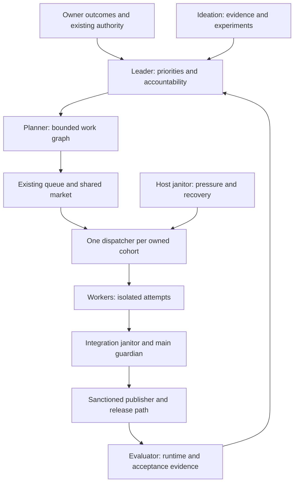

# Fleet strategy: the next 30 days

Date: 2026-11-14. Horizon: November 14 through December 13, 2026.
Job: RQ-CMP-STRATEGY-BRAIN-1. Status: proposed delivery plan, docs only.
Source baseline: `c5fed9a5a70dc51721b660d69179581f120296c7`.

**Spend the month making the existing fleet finish valuable work reliably.**
Phantom already has planners, workers, capability routing, repair loops, fenced
node claims, evaluators and research intake. Its largest opportunity is connecting
these into an accountable path from an owner outcome to accepted delivery.
Increasing launches before measuring that path risks buying more unfinished work.

The target is the [North Star](../NORTH-STAR.md): an autonomous engineering
organization that discovers opportunities, builds, integrates, operates and learns.
This plan operationalizes [ENDSTATE](ENDSTATE.md), especially its shared work
market and outcome contracts. It does not commission a second strategy engine.

## Evidence boundary

The audit read [AGENTS.md](../../AGENTS.md), [agent operations](../AGENT-OPERATIONS.md),
the [constitution](../../CONSTITUTION.md), and surveyed `src/core/fleet/`,
`src/core/drive/` and `contrib/mac/`. The [module map](MODULE-MAP.md) supplies the
broader inventory; the claims below were checked against the named source modules.
This is an architecture and control-flow audit, not an exhaustive execution of
every fleet feature or a certification of the running host.

The supplied 2026-11-14 04:27:52 roster reports live workers and a 300-open-PR
snapshot, but only an excerpt of PR titles. That is evidence of activity and
possible integration debt, not a measured throughput rate. Connected GitHub
searches found no open PR matching this job ID or `FLEET-30D`. Recheck claims and
open PRs before assigning each implementation slice; existing repair and bridge
jobs retain ownership. In particular, build on the implemented shared market and
the existing multi-Mac work rather than creating competing versions.

Installed `phm` reported 3.30.24; this checkout declares 3.30.33. The required
global installation attempt was refused by filesystem permissions. Command
discovery and MCP listing succeeded; wire status could not read several client
configs. These facts establish version and access uncertainty, not runtime failure.
No live queue, controller mode, deployed digest, grant, quota or release acceptance
was verified. All scores and targets below are proposals, not observed gains.

## What the fleet can do today

“Implemented” means a source path exists. Deployment, activation and observed
success are separate facts that need their own receipts.

| Capability | Implemented evidence | Distance from an autonomous organization |
| --- | --- | --- |
| Choose direction and assign responsibility | [Leader](../../src/core/vision/leader.ts) consumes outcome/capacity digests, tries alternative seats and grades moves; [leader office](../../src/core/agents/leader-office.ts) maps assignments to roles and shared claims. | Strategic accountability exists, but the Mac planner has a separate scheduling/health path. A role assignment does not prove a productive planner pass or accepted delivery. |
| Generate useful work | [Research proposals](../../src/core/research/proposals.ts) score, deduplicate and admission-lint digests; [research restock](../../src/core/driver/research-restock.ts) emits bounded research jobs; [selector](../../src/core/routing/selector.ts) ranks value, leverage and learned costs. | Source provenance is stronger than an arbitrary task list. Product adoption and post-delivery results still need to close the selection loop. |
| Plan and replenish | [Planner autorun](../../src/core/fleet/planner-autorun.ts), [runner](../../src/core/fleet/planner-run.ts), [restocker](../../contrib/mac/restock.py) and [self-tick](../../src/core/fleet/self-tick.ts) implement supply checks, candidate execution, dependency parking and recurring maintenance stages. | The autorun decision can refuse before candidate failover. Supply counts differ between producers; counted READY work need not be runnable. |
| Allocate across providers | [Shared work market](../../contrib/mac/work_market.py) evaluates capability, tier, cost class, holds and capacity; [dispatchd](../../contrib/mac/dispatchd.py) uses it and preserves route hysteresis. | This is already implemented. Reconcile eligibility across queue producers and the [Drive supervisor](../../src/core/drive/supervisor.ts), whose planner still selects within declared pools. Deployment parity is unproven. |
| Execute bounded work | dispatchd launches existing sandbox runners, tracks attempts, limits launches and batches related jobs. Drive models `STARTING`, `PUBLISHING` and `PUBLISH_UNKNOWN`; its [script bridge](../../src/core/drive/script-bridge.ts) requires an owned executable and `publish.sh`. | Strong primitives, multiple host contracts. An exit code or published PR still does not prove merge, release or acceptance. |
| Repair and integrate | [Refix loop](../../src/core/drive/refix-loop.ts) reserves bounded branch updates and drain jobs; [merge autopilot](../../src/core/fleet/merge-autopilot.ts) classifies live PRs and creates fixes; [guardian manifest](../../src/core/fleet/guardian-manifest.ts) feeds verification and [retry drain](../../src/core/fleet/guardian-retry-drain.ts) bounds infrastructure retries. | Repair is real. Separate discovery scopes, journals and activation conditions can leave PRs unseen or repeatedly repaired. Source presence does not prove the timers are running. |
| Regulate host pressure | [Fleet controller](../../contrib/mac/fleet_controller.py) centralizes slot writes, shedding, rebalancing and producer backpressure; dispatchd has phase deadlines and an independent admission gate. | Controller phases B/C default to shadow. Backpressure expires; actual enforced behavior must be observed. More configured slots cannot overcome a closed host gate. |
| Survive node failure | [Node router](../../src/core/drive/nodes/router.ts) accounts for leases/capacity; [pool](../../src/core/drive/nodes/pool.ts) uses a designated witness, epochs and a 15-minute promotion threshold. | A useful failover design, not high availability by assertion. [Primary admission depends on the backup witness](../../src/core/drive/nodes/pool-host.ts); publication is a separate continuity problem. |
| Measure and learn | [Production ledger](../../src/core/fleet/dispatch-production-ledger/types.ts) has attempt/provenance contracts; [job latency](../../src/cli/fleet-job-latency.ts) rejects ambiguous boundaries; [eval report](../../src/core/fleet/eval-report.ts) distinguishes pending, stable and unobserved merges; [skill calibration](../../src/core/fleet/skill-routing-calibration.ts) checks routing evidence. | These are different populations and evidence strengths. Merge durability is not product acceptance; missing coverage cannot earn success credit. |
| Remember and coordinate | [Context pack](../../src/core/fleet/context-pack.ts) compacts fleet state, blockers, threads and pinned context; [claim store](../../src/core/agents/claim-store.ts) coordinates overlapping work. | A context builder exists. Delivery into every worker launch, freshness, completeness and reduced duplicate work still need measurement. |
| Release and adopt changes | [Release chain](../../src/core/fleet/release-chain-status.ts) joins signing and feed receipts; [machinery manifest](../../fleet/manifest.json) distinguishes managed, manual and pinned files. | A source merge, signed artifact, published feed and running process are different milestones. Manual/pinned host adoption remains an explicit seam. |
| Run unattended product autonomy | [Daemon phases](../../src/core/daemon/tick-phases.ts) bound awaited work; the [activation permit](../../src/core/daemon/activation-permit.ts) defines daemon and conductor authority. | The daemon and goal-conductor activation root arrays are empty at this baseline. Do not confuse the active Mac fleet with a commissioned general-purpose resident organization. |

## Three likely silent throughput ceilings

These are code-backed failure mechanisms to measure first, not claims that all
three are occurring on the host today. “Silent” means a healthy process or large
queue can conceal lost useful work even when a local reason is logged.

### 1. Supply can be full on paper and starved in execution

[Queue gate `allowance`](../../contrib/mac/queue_gate.py) targets
`max(8, ceil(2.5 * cap))` distinct non-parked rows. It validates row shape and tier,
but does not evaluate lane health, capabilities, fresh quota or prompt existence.
dispatchd checks those later. Enough unusable rows can therefore exhaust producer
allowance while capable workers have nothing runnable.

There is a second liveness failure in [autorun](../../src/core/fleet/planner-autorun.ts):
`health.status === 'failing'` returns `planner-failing` before a new pass is chosen.
The [CLI](../../src/cli/fleet-planner-tick.ts) only reads the candidate slate after
a RUN decision, although [candidate selection](../../src/core/fleet/planner-failover.ts)
can skip a limited provider. The normal timer path can suppress the fallback that
would restore supply. Its defaults also use a fixed 24-job threshold, a six-job
critical floor and a 25-minute interval, rather than measured runnable demand.

**Detect:** eligible READY depth per capability/tier, idle eligible slot-minutes,
oldest useful queue item, last productive planner output and refusal reasons.
**Response:** priorities 1 and 5. Keep unlaunchable work visible; do not discard
history, fabricate eligibility or refill with maintenance merely to occupy seats.

### 2. Integration can become a slower queue than implementation

[Refix](../../src/core/drive/refix-loop.ts) defaults to fleet-bot authors, caps new
drains/updates at 20 per cycle and limits each PR to three attempts per 24 hours.
[Merge autopilot](../../src/core/fleet/merge-autopilot.ts) discovers candidates
through fleet merge-state records; corrupt/missing records are skipped, and apply
requires its explicit armed configuration. It repairs PRs; the standing merge
pass owns green merges. [Queue latency](../../src/core/fleet/queue-latency.ts)
only advises and routes repeated recuts to `needs_person`.

Those bounded controls prevent retry storms. Their combined discovery coverage
and handoffs can nevertheless strand a PR, especially across publishers/authors.
More implementation then creates more overlapping changes, stale heads and drain
work. The supplied PR excerpt makes this worth investigating; it cannot establish
arrival rate, service rate or the fraction of PRs actually ready to merge.

**Detect:** PR arrivals versus verified merges, p90 ready-to-merge wait, oldest
unowned repair, duplicate repair attempts and live-state read coverage.
**Response:** priority 2. Preserve required merge-queue checks and retry bounds;
route exhausted engineering repairs to a responsible specialist, with the original
lineage and limits, instead of defaulting every exhaustion to Mason.

### 3. One host and its adopted control plane bound every lane

[dispatchd](../../contrib/mac/dispatchd.py) takes a kernel lock for the complete
tick, permits at most eight launches per tick, and gates all launches on pause,
disk and host admission. Its optional-work budget defaults to 90 seconds, with
separate phase deadlines; this is not a promise of a 90-second total tick.
The `ready.lock` scope is already narrow, so “remove the global queue lock” would
misdiagnose the current code. Provider seats still share checkout, process,
verification, storage and publication capacity on the Mac.

The controller's default shadow mode does not apply graduated shedding or
rebalance/backpressure. The [manifest](../../fleet/manifest.json) also leaves
launcher, publisher and several wrappers pinned or manual: merging source does
not update them. The [node pool](../../src/core/drive/nodes/pool.ts) fences a
returning primary, but its designated witness remains a deliberate availability
dependency, and it does not establish alternate signing/publication custody.

**Detect:** tick/phase age, launch refusal time by cause, source-versus-running
digest, host pressure, verification wait and witness availability.
**Response:** priorities 4, 7 and 9. Recover/adopt the existing machinery and
offload bounded worker execution before adding scheduler replicas or raising caps.

## Ranked implementation portfolio

Rank = impact × feasibility, each 1–5. Impact 5 affects fleet-wide completion or
the owner-to-product loop; 4 affects several lanes/stages; 3 improves one repeated
cost. Feasibility 5 means an estimated 1–3 engineer-days using existing seams,
4 means 4–7, and 3 means 8–14 including integration evidence. These are planning
estimates, not probabilities. Ties favor liveness and prerequisite value.
Effort excludes waiting for any required Security pin or device ceremony.

| Rank | Gap | Impact | Feasibility | Score | Accountable role | Prerequisites |
| --- | --- | ---: | ---: | ---: | --- | --- |
| 1 | Planner failure prevents productive fallback | 5 | 5 | 25 | Orchestrator | None |
| 2 | Unowned integration debt and competing repair producers | 5 | 4 | 20 | Integration janitor | Baseline from 3; inventory can start immediately |
| 3 | Incomplete outcome/attempt accounting across execution paths | 5 | 4 | 20 | Orchestrator + evaluator | None |
| 4 | Controller behavior and host adoption are unproven | 4 | 4 | 16 | Host janitor | 3; required pin handoff |
| 5 | Producer capacity differs from runnable market demand | 5 | 3 | 15 | Orchestrator | 1, 3; extend shared-market owner |
| 6 | Research rarely proves an accepted product outcome | 5 | 3 | 15 | Ideation + product owner | 2, 3 for delivery; selection starts day 1 |
| 7 | Recovery semantics differ between queues and nodes | 4 | 3 | 12 | Orchestrator + host janitor | 3, 5; coordinate multi-Mac work |
| 8 | Learning uses proxies without a common acceptance population | 4 | 3 | 12 | Evaluator | 3, first delivery cohort from 6 |
| 9 | Merged improvements lack running-version acceptance | 4 | 3 | 12 | Release owner | 3, 4; sanctioned release/custody path |
| 10 | Workers repeat discovery and miss current ownership | 3 | 4 | 12 | Worker platform owner | 3; existing context/claim contracts |

### 1. Make planner failover reachable

Extend `decidePlannerAutorun`, `planPlannerPass` and the planner-tick CLI named
above. Decide whether planning is needed separately from which eligible provider
can do it. Persist health by candidate identity; try only configured candidates
within existing resource admission, with one bounded attempt at a time. A failed
last provider must not veto healthy alternatives. Preserve ORCH_OFF and report
all-candidates-unavailable with the next retry evidence. Treat productive output,
not process exit zero, as recovery; the CLI already has output-evidence checks.

Acceptance: extend [autorun](../../test/planner-autorun.test.ts) and
[failover](../../test/fleet-planner-failover.test.ts) coverage for exhausted first
candidate, healthy second candidate, all blocked and unreadable evidence. A host
replay reaches the eligible fallback on the next due tick without duplicate passes.
Scope the first PR to this liveness fix; supply policy follows in priority 5.

### 2. Give integration one accountable owner per PR

Extend refix, merge autopilot and [PR hygiene](../fleet/pr-hygiene.md). Join their
observations by repo, PR, head SHA and repair generation; reconcile unknown effects
before retry. Choose one existing repair producer for each cohort and make the
others observers. Surface discovery exclusions and corrupt records as counts and
owned incidents. Preserve holds, author scope and publication authority; expanding
discovery does not automatically authorize effects on an arbitrary PR.

Use observed integration capacity to limit new feature work in flight for a repo
or overlapping path group, while reserving useful repair capacity. Start with a
proposed 20% of eligible worker capacity for integration/guardian work, released
when no repairs exist. Acceptance: one repair per head/generation in a replay of
both loops, bounded exhaustion with an owner, and a 50% reduction in p90 eligible
PR wait versus days 1–3 without a higher observed regression rate. Reuse
[refix tests](../../test/refix-loop.test.ts); keep required checks intact.

### 3. Measure one outcome through every attempt

Extend the production ledger's existing attempt identity, dispatchd lifecycle
events and job-latency projection. Join owner outcome → job → attempt → artifact →
PR/head → merge SHA → release → acceptance using explicit IDs and provenance.
Retain separate failed, empty, cancelled, pending and unobserved states. Existing
journals remain authoritative for their stages; build a reconciled projection
before attempting a storage migration. Do not infer an attempt from timestamp
proximity or award several outcomes for recuts of one fix.

Acceptance: replay duplicate, delayed, missing and conflicting events; counts
remain invariant to replay, ambiguous joins remain unknown, and at least 95% of
new cohort attempts have launch/terminal attribution after seven days. Show the
denominator and observation coverage. Extend [latency tests](../../test/fleet-job-latency.test.ts)
and the production-ledger suites. This is the baseline for every claimed gain.

### 4. Prove and adopt the existing host controller

Extend controller receipts and the manifest's adoption evidence. Capture source
digest, installed digest, process identity, mode, selected phases, last tick and
actual refusal causes. Replay current pressure/queue observations through
`fleet_controller.plan` and `backpressure`, then commission a bounded cohort
through the existing reviewed host path. This document does not switch a mode,
change a pin, install a launcher or weaken admission thresholds.

Acceptance: [controller tick tests](../../contrib/mac/tests/test_fleet_controller_tick.py)
cover stale inputs and degraded observations; a seven-day cohort has no duplicate
slot writers, no safety-bound increase and lower pressure-blocked slot-minutes.
Record adoption latency separately from code delivery. If it is already enforced
and healthy, close the commissioning slice with receipts and address the measured
host bottleneck instead of rewriting the controller.

### 5. Count executable supply at the shared market seam

Extend `work_market.lane_view/choose`, `queue_gate.allowance`, restock and
`ready-supply.ts`. Keep total backlog depth, but add eligible depth by required
capability/tier with source freshness and reason counts. Reuse the same admission
inputs as dispatch; avoid another approximate eligibility algorithm. Let a held
lane's queued work stop suppressing useful supply for an eligible lane, while
preserving local-only execution, cost ceilings, owner scope and route hysteresis.
Make dependency milestones explicit: local DONE is not verified MERGED.

Acceptance: replay held lanes, missing prompts, dependency parking, fresh/reset
quota and unknown capability evidence. No duplicate launch; eligible idle time
falls by 50% against the baseline. Add cases to the existing
[market](../../contrib/mac/tests/test_work_market.py) and
[restock](../../contrib/mac/tests/test_restock.py) suites. Coordinate with the
shared-market owner; TSV/Markdown compatibility remains until all consumers agree.

### 6. Deliver two product bets through the complete loop

Extend research proposals, selector, Leader goals and
[goal graph execution](../../src/core/fleet/graph-goals-run.ts). For every bet,
record the observed user problem, competing explanations, smallest useful change,
acceptance journey, owner and stop condition. Deduplicate against claims, queued
work and shipped outcomes before decomposition. Select two bets by day 3, such
as a verified cold-start engineering flow and a reliable owner-request-to-result
flow, only if current failure evidence supports them.

Acceptance: each chosen bet has a reproducible before/after journey, an integrated
artifact, sanctioned release evidence where needed and an independent acceptance
result. Report the actual result even when the experiment fails. Reuse
[research-proposal tests](../../test/research-proposals.test.ts); evaluate product
behavior in its owning suites. Stop a bet after two bounded attempts without new
evidence and return the capacity to the ranked slate. No research quota creates
filler work. This is the month's ambition beyond machinery repair.

### 7. Recover abandoned work without creating two owners

Extend [QueueStore](../../src/core/queue/store.ts) and the node pool's existing
lease/fencing primitives. QueueStore's lock uses exclusive file creation and a
five-second wait but deliberately never steals a lock; its claims record an
owner/time without an expiry. A crashed writer or abandoned claim therefore needs
explicit reconciliation, unlike the node router's expiring fenced claims. Map
legacy claims to a versioned recovery state rather than guessing they are dead.

Acceptance: kill/restart tests at reservation, launch, completion and publication
handoff reject an old owner's writes and never launch twice. An unreachable witness
closes admission visibly; test recovery after it returns. Extend
[node tests](../../test/drive-nodes.test.ts) and
[Drive tests](../../test/drive-supervisor.test.ts). Target recovery within two
declared lease intervals; retain the pool's current 15-minute promotion rule until
separately evaluated. Coordinate with open multi-Mac work. Do not relocate signing
custody or promise publication failover from worker failover evidence.

### 8. Route on observed useful outcomes

Extend eval-report, [post-merge stability observation](../../src/core/fleet/post-merge-stability-observer.ts),
selector and existing outcome-learning/calibration modules. Keep merge, observed
durability and product acceptance as separate labels. Include repair cost and
failed attempts in comparisons; report missing usage and cost as unknown.
Stratify by task class/repo/tier, retain sample sizes and uncertainty, and compare
candidate routing in shadow before changing assignments. Preserve a small,
bounded exploration share within existing capacity so early winners do not
monopolize the data used to rank them.

Acceptance: a fixed replay cannot turn missing coverage into success; a held-out
cohort improves accepted outcomes per measured hour without worsening regression
or quota-refusal rates. If sample size is inadequate, retain deterministic routing
and report “insufficient evidence.” Extend [eval-report tests](../../test/fleet-eval-report.test.ts).
Use the existing 72-hour durability window; an elapsed window alone is not
independent product acceptance.

### 9. Close the merge-to-running-version gap

Extend release-chain status, the machinery manifest and guardian evidence. Join
the sanctioned release's source/artifact identity to observed runtime identity
and an acceptance probe. Distinguish merged, packaged, signed, published,
installed, running and accepted. Give every stalled transition an accountable
owner and elapsed time. Read-only diagnosis can ship separately from any pinned
publisher, signer, launcher or activation change.

Acceptance: a successful signer with no feed receipt stays unknown, an old running
process cannot claim the new change, and each chosen product bet reaches its
declared acceptance milestone. No inferred key, copied login or broadened grant.
The resident daemon/conductor's empty trust roots require their own existing
commissioning process; they are not a shortcut to meeting this month's targets.
Fix defects forward through sanctioned publication and preserved security controls.

### 10. Give each worker fresh context and ownership evidence

Extend context-pack, [node context](../../src/core/fleet/node-context-pack.ts) and
claim-store consumers at the existing launcher seam. Include scoped outcome ID,
source revision, acceptance command, overlapping claims/PRs, dependency evidence
and selected proven lessons under a fixed context budget. Record pack identity,
age and truncation; preserve owner/client visibility. The existing pack builder
records token-budget metadata in the event log, so its invocation is not a pure
read. Context remains untrusted evidence and cannot widen task authority.

Acceptance: [node context tests](../../test/node-context-pack.test.ts) cover
visibility, stale facts and truncation; a matched cohort reduces duplicate work
and startup discovery time without lower acceptance. Target a 30% reduction in
measured discovery time, and reject the change if context cost consumes the gain.
Retire redundant prompt assembly only after consumer parity is demonstrated.

## Concrete organization and control ownership

Roles are durable responsibilities; model sessions are replaceable executors.
Select providers through existing capacity/admission. Do not bind strategic
authority to one vendor or create a permanent expensive process for every title.

| Role | Concrete existing runtime/module | Owns | Missing or to prove |
| --- | --- | --- | --- |
| Leader | `vision/leader.ts` under the daemon's Leader cadence; `agents/leader-office.ts` for responsibility; Mac planner slate for current fleet planning | Ranked owner outcomes, product bets, stopping low-value work, weekly evidence review | Reconcile Leader and Mac planner responsibilities; one accountable owner per outcome and productive-pass fallback. No assumption that the resident daemon is activated. |
| Orchestrator | Host `dispatchd.sh` invoking `contrib/mac/dispatchd.py`; restock, work market, planner-tick and self-tick | Eligibility, reservations, dependency progress, attempts and bounded recovery | Shared runnable-supply contract and attempt lineage. `drive/supervisor.ts` is an alternative through its bridge, not a second concurrent writer of the same cohort. |
| Workers | Existing `launch.sh`/sandbox runners and engine registry; `drive/nodes/worker.ts` for node execution | One claimed slice, reviewable artifact, verification and explicit outcome | Uniform context and completion receipts across launch paths; stop/retry behavior proven under lease loss. |
| Integration janitor / main guardian | Refix, merge autopilot, guardian manifest/verification/retry drain; existing host timers where commissioned | PR repair ownership, required-check compliance, scheduled-main failures, fix-forward work | Coverage across actual publishers, one repair producer per cohort, terminal exhaustion ownership and measured service capacity. |
| Host janitor | self-tick for reset/stray recovery, fleet controller, `contrib/mac/wt-prune.py`, manifest tooling | Tick health, pressure, abandoned attempts, safe reclamation and adoption evidence | Timers/digests verified on host; dirty or pinned worktrees protected; slow housekeeping must not delay dispatch. |
| Ideation / evaluator | Research-restock/proposals, selector, Leader feedback, eval-report and post-merge observers | Evidence-backed opportunities, independent acceptance, falsifiable learning | Scheduled handoff into bounded product bets and verified results back into ranking. These modules do not themselves prove an always-on ideation daemon. |
| Release owner | Existing pinned publisher and release workflows; release-chain reader | Artifact-to-runtime continuity and acceptance | Current signer/feed/runtime receipts; worker failover grants no release custody. Security handles required pin changes through the existing process. |

The orchestrator owns the queue transition, the worker owns its attempt, and the
integration owner owns the PR handoff. The Leader owns the outcome until acceptance
or an explicit stop decision. A “done” worker cannot silently transfer that duty to
Mason. Janitors use deterministic checks first and request bounded repair work
when judgment is needed. Escalation retains the actual hard limits and owner holds.

## Thirty-day execution and scorecard

Use existing granted capacity. Suggested allocation during week 1: 50% completion
and reliability, 30% the two product bets, 20% integration/verification. After the
first acceptance receipts, move toward 60% product, 20% reliability and 20%
integration. These are work shares, not new seats, spending authority or rigid
vendor quotas. Unused repair capacity returns to eligible useful work.

| Window | Concrete deliverable | Exit evidence / decision |
| --- | --- | --- |
| Days 1–3: Nov 14–16 | Baseline one repo across the full path; verify actual timers, modes, digests and source coverage; fix planner failover; select two product bets. | Snapshot coverage and denominators published in a private evidence bundle. Reconcile live claims before filing work. Unknown data is a work item, not a zero. |
| Days 4–7: Nov 17–20 | One integration owner per cohort; attempt joins; shadow host-controller comparison; first small product slice. | Duplicate-repair replay passes, planner fallback works, and one useful slice reaches the integration path. Choose the largest measured wait, rather than assuming provider scarcity. |
| Days 8–14: Nov 21–27 | Eligible-supply projection and bounded recovery cases; adopt only reviewed host changes; deliver the first accepted bet. | No double launches in fault tests; observable queue and host refusal causes; a reproducible acceptance receipt. If integration wait remains dominant, hold feature expansion and drain it. |
| Days 15–21: Nov 28–Dec 4 | Second bet; context cohort; quality/routing shadow evaluation; worker failover rehearsal. | Acceptance and cost coverage shown by cohort. No claimed optimization from an incomparable task mix or missing data. |
| Days 22–30: Dec 5–13 | Prove running-version adoption; observe durability; remove superseded adapters only after parity; publish next-month decisions. | Two independently accepted outcomes or explicit failed-bet evidence; retire mechanisms that did not improve yield. Allow 72 hours of observation before calling late merges durable. |

Day-30 objectives, compared with the days 1–3 baseline on comparable work:

- Two useful product outcomes accepted; count an outcome once across all PRs.
- At least 95% attempt-boundary coverage and 90% merge-to-observation coverage
  in the selected cohort. Show unknowns and pending windows beside both rates.
- 50% lower p90 eligible PR integration wait and 50% lower avoidable eligible
  idle slot-minutes. Report sample counts; do not generalize a tiny cohort.
- Higher accepted outcomes per measured worker-hour; no increased observed
  regression rate or quota-refusal rate. Token and cash ratios require measured
  denominators and coverage, not imputed zeros or blended incompatible units.
- Zero duplicate launches/publications in recovery acceptance cases; no raised
  security authority, weakened checks or new spending to obtain the improvement.

Daily: the orchestrator records the largest measured wait and its responsible
owner. Weekly: the Leader keeps, changes or stops each bet using the result.
If source coverage is too weak to compare yield, prioritize closing that gap and
withhold a success claim. If a component is already deployed and meets its exit
criteria, close the proposal with evidence and spend on the next ranked gap.

## Deliberate cuts and delivery boundaries

Do not add another scheduler, generic strategy service, credential store, dashboard
or queue solely to implement this plan. Do not fill idle seats with repeated audits
or blanket test-generation jobs. Do not replace bounded retry caps with unlimited
recuts. Do not remove safety gates to raise utilization. Reuse the existing
[dead-code review](DEADCODE-REPORT.md); retire code only in its owning implementation
slice after proving consumer and operational parity. This docs-only change deletes
no runtime code.

Keep Security GATES v3, the owner hold list, required merge-queue checks, fork-only
publication through the sanctioned `publish.sh`, private-data boundaries and local
loopback inference. Host/release scripts and leader wrappers follow their existing
Security pin handoffs; this plan authorizes no live installation. Routine work
within standing scope needs no new human gate. Passwords, 2FA, device approvals,
payments and other retained boundaries remain exceptions.

This strategy is a reviewable PR payload. Per this job's delivery instruction,
changes stay uncommitted for the existing publisher to collect; no commit, push,
tag, PR creation, release or publication occurs in this session. Verification and
remaining limitations are recorded in the root `BRIDGE_NOTES.md` handoff.
